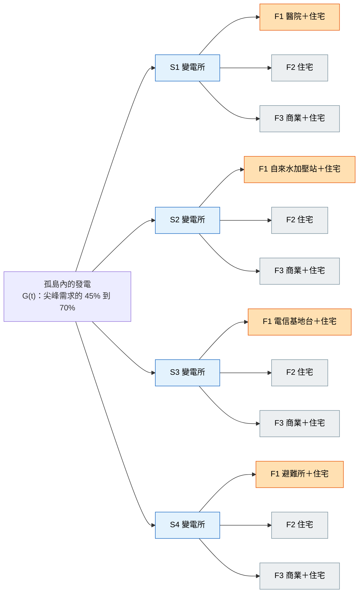
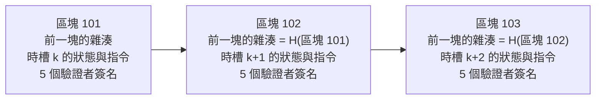
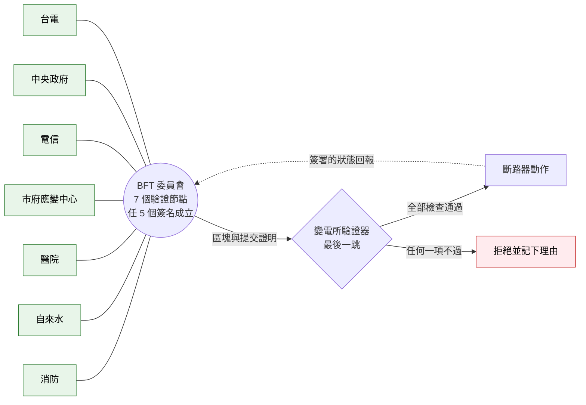
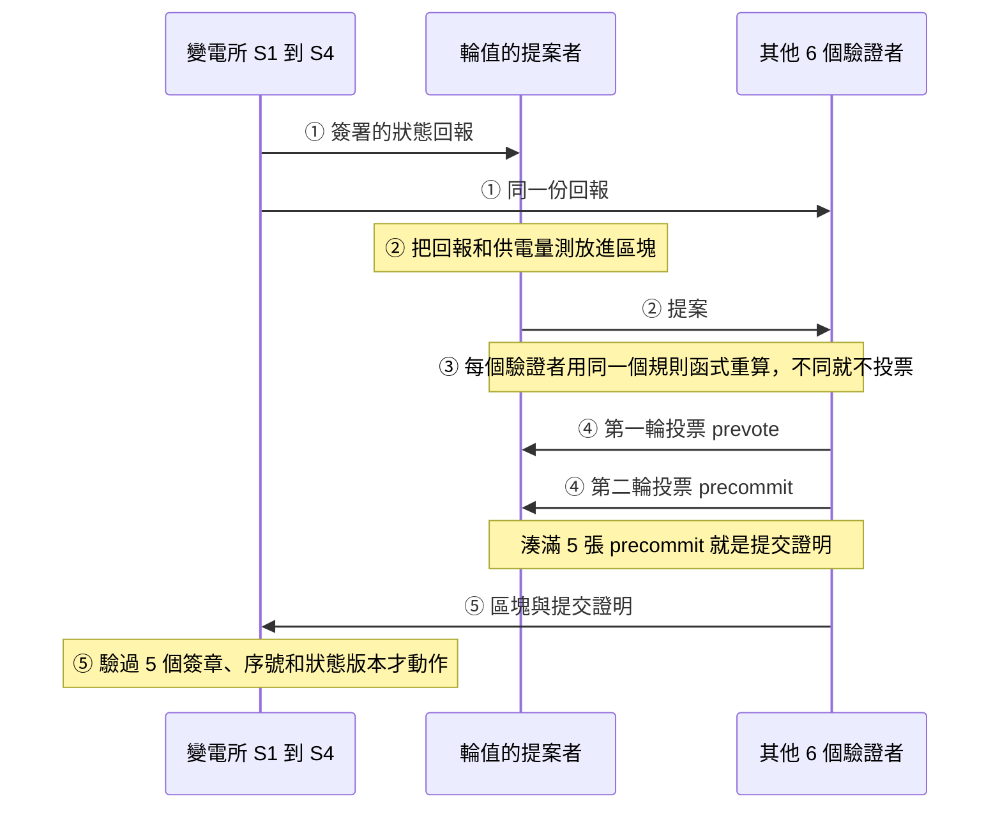
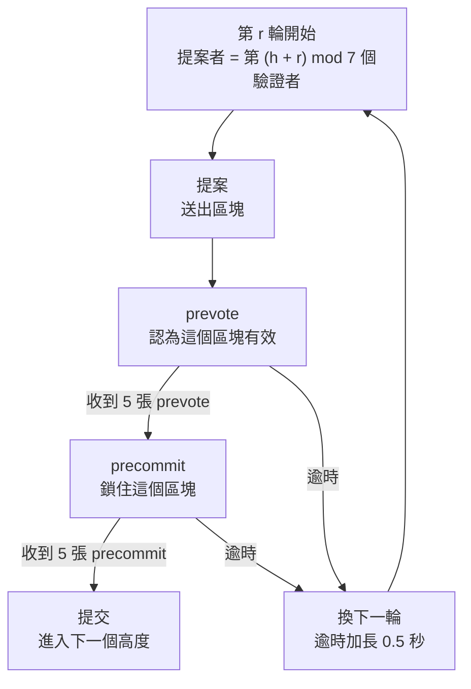
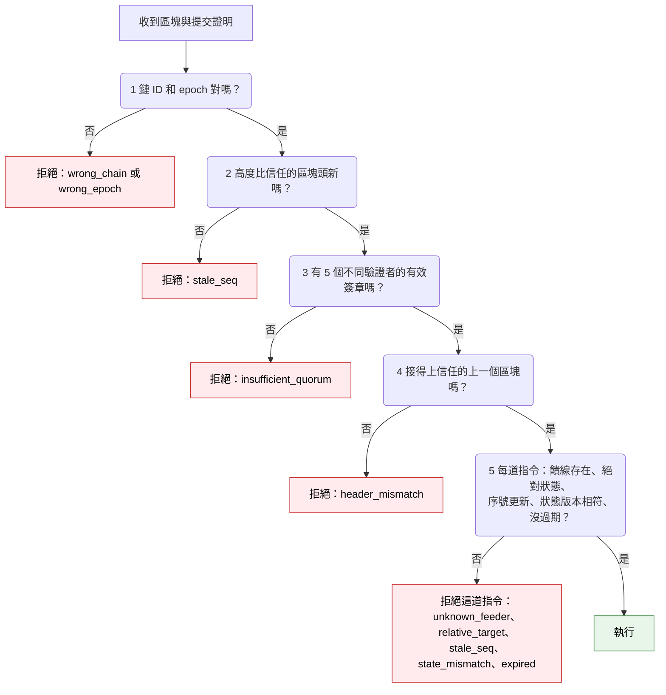
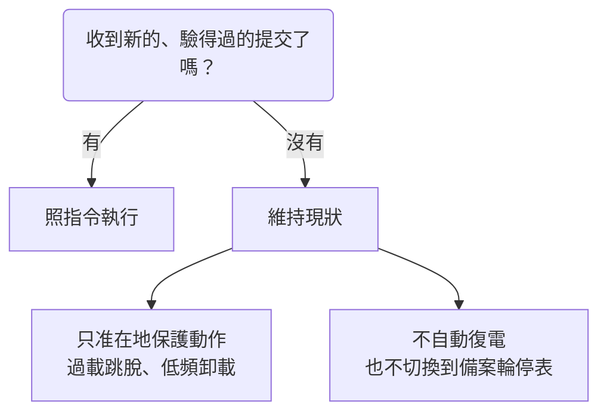
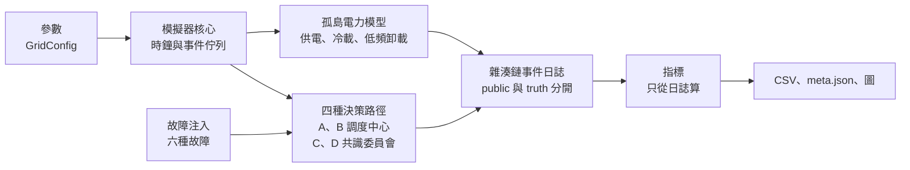
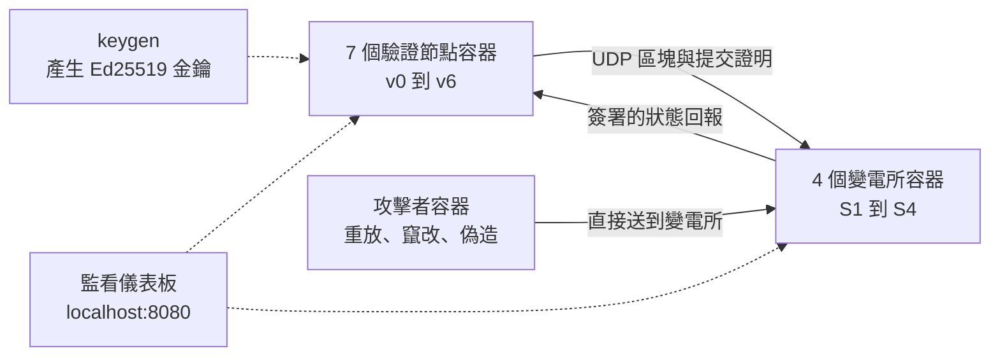

# 戰時電網緊急分配：調度中心被駭或被炸，剩下的電仍照規則分配

> **課程**：區塊鏈導論　期末專題
> **組員**：（待填）
> **附錄**：（貼上附錄的 HackMD 連結）。附錄收錄完整參數、協議細節、每個實驗的全部數字和重現步驟；本文提到「附錄 X」時指的就是那份文件。

[TOC]

## 摘要

戰爭時輸電線被打斷，電網會裂成一塊塊「孤島」。島內的發電不夠用，只能輪流停電，而且每幾分鐘就要重新決定誰有電、誰沒電。做這個決定的調度中心本身就是攻擊目標：它可能被駭，也可能被炸。本專題的核心想法是「**信任政府的決策，不信任每一台電腦**」：政府定的優先順序和輪停規則寫成程式，由台電、中央政府、市府應變中心、醫院、自來水、電信、消防 7 個組織各跑一個節點，組成一條許可制區塊鏈（用拜占庭容錯共識，簡稱 BFT）。7 個節點中任 5 個簽名，指令才算數；變電所自己檢查簽名、順序和狀態，不相信中間轉送的人。

我們寫了一個只用 Python 標準函式庫的模擬器，在同一套規則和情境下比較四種調度架構（中央調度加備援、再加上變電所在地檢查、台電內部 BFT、多組織 BFT），注入六種故障；另外用 Docker 在真的網路上跑 7 個驗證節點和 4 座變電所。主要結果：

- **容錯內不出錯**：被駭加失聯的節點不超過 2 個時，雙重簽名、離線、網路分區都沒有造成任何衝突的決策；超過時系統停下、維持現狀，恢復後約 52 秒接上。
- **舊指令重放全部擋下**：變電所檢查序號和狀態版本時，16,248 道重放的舊指令一道都沒執行；只數簽名的話，全部都會被執行。
- **被駭的調度中心擋得住**：被駭的中心下「全部復電」，中央調度（A、B）打擊後 89% 的時槽觸發低頻卸載；BFT（C、D）只要攻擊者拿不到 5 把金鑰，一道都不執行。
- **供電比預期少也不會過載**：供電只剩 25% 時，照 40% 事先排好的輪停表（B）有 91% 的時槽低頻卸載；BFT 依當下的供電重算，一次都沒有。
- **代價**：一個孤島區域一次約 1,500 萬到 8,000 萬元、每年 150 萬到 700 萬元，沒有手續費，也不需要代幣；節點變多，資料被讀走的入口也變多。

:::spoiler 名詞速查（點開）
| 名詞 | 白話解釋 |
|---|---|
| 孤島 | 和大電網斷開、只能靠區域內發電的一塊電網 |
| 饋線 | 從變電所拉出去的一條配電線，是調度能切換的最小單位；一條線上通常同時有醫院和住宅 |
| 輪停 | 輪流停電：電不夠時，讓不同饋線輪流停電 |
| 低頻卸載（UFLS） | 用電超過發電時頻率會下降，保護裝置在幾秒內自動切掉一段段饋線，不管政府的優先順序 |
| 冷載 | 停電一陣子後再送電，冷氣、冰箱、馬達同時啟動，負載暫時比平常高 |
| 調度中心 | 決定哪些饋線停電、哪些送電的系統 |
| 區塊鏈 | 多個組織共同維護、用雜湊串起來、改不了的帳本 |
| 許可制區塊鏈 | 只有事先指定的組織能記帳的區塊鏈，和比特幣這種任何人都能加入的公有鏈相對 |
| 節點、驗證者 | 參與共識、替區塊簽名的電腦；本專題有 7 個 |
| 拜占庭容錯（BFT） | 一部分節點說謊或失聯時，其餘節點仍能達成一致的共識方法 |
| f | 最多能容忍幾個壞節點（被駭加失聯合計）；7 個節點時 f = 2 |
| Q（門檻） | 一個決定成立需要的簽名數；7 個節點時 Q = 5 |
| 提交證明（commit proof） | 一個區塊加上至少 Q 個不同驗證者的簽名，證明委員會真的通過了它 |
| 輕節點 | 不參與共識、只檢查區塊和簽名的參與者；本專題的變電所就是輕節點 |
| 重放攻擊 | 把以前合法的訊息錄下來，之後再送一次 |
| 狀態版本 | 變電所的狀態每變一次就加一的號碼；指令要寫明它依據哪個版本 |
| epoch | 驗證者名單的版本號，換名單就換 epoch |
| 共因失效 | 一次事件同時打倒好幾個節點，例如同一家公司的帳號被盜 |
:::

## 1. 前言：為什麼做這個題目

### 1.1 戰時，調度系統本身就是攻擊目標

電網被攻擊不是假設，而是已經發生過的事：

- **2015 年 12 月，烏克蘭**：攻擊者在配電公司的網路裡潛伏了好幾個月，最後從調度系統遠端跳開斷路器，約 22.5 萬用戶停電數小時 [1]。
- **2022 年 4 月，Industroyer2**：一支直接對高壓變電所下指令的惡意程式，就在變電所的網路內部執行，最後被攔下 [2]。
- **2025 年 10 月，烏克蘭**：俄羅斯攻擊之後，國家電網公司 Ukrenergo 仍對 12 個州發布分時停電表 [3]。電不夠、要輪停，在戰時是每天的事，而且每天都要有人算。
- **台灣**：303 大停電後的「強化電網韌性建設計畫」，2022 到 2032 年投入 5,645 億元，其中分散 4,379 億、強固 1,250 億、強化系統防衛能力 16.9 億（約 0.3%）[4][5]。我們讀到的說明裡，「外力」指的是動物、雷擊和天候，沒有談到調度系統被入侵。

所以我們的出發點是資安上常說的「**假設已被攻破**」（assume breach）：不問會不會被駭，而是問被駭或被炸之後，剩下的電還能不能照規則分給醫院、加壓站和基地台。戰爭是最極端的情況；平時面對國家級攻擊者的關鍵基礎設施，其實也是同一個問題。

### 1.2 一句話目標

:::success
**孤島化的區域裡，即使調度中心被駭或被炸，剩下的電仍照政府定的規則、依當下的電力狀態分配。**

核心想法：信任政府的決策，不信任每一台電腦。
:::

決定權仍然在政府。我們不是要讓區塊鏈「決定」誰有電，而是讓政府的規則不會因為一台電腦被駭就被改掉。可以類比核武的雙人規則：發射權在元首手上，但沒有任何一個人能單獨執行。

### 1.3 我們做了什麼

- **設計**：7 個組織組成的許可制 BFT 委員會、變電所端的驗證（我們稱為「最後一跳」），以及湊不滿門檻時的保守降級規則。
- **模擬器**：只用 Python 標準函式庫，在同一套政策下比較四種架構，注入六種故障，有 184 個自動測試；每個結果都附設定和 git commit，可以重跑。
- **Docker 展示**：11 個容器、真的 Ed25519 簽章和 UDP 網路，8 個情境、26 項檢查。
- **營運模式與成本**：誰來營運、誰付錢、在什麼條件下值得建。

:::warning
這是期末專題。結論是「**在指定協議假設下的模型驗證**」，不是對實際 BFT 引擎的形式證明，也不是可以上線的系統。電力物理只做簡化，機率和成本是假設或粗估，限制集中寫在第 10 節。
:::

接下來，第 2 節先補背景知識，第 3 節看前人做到哪裡，第 4、5 節定義問題並說明為什麼要用區塊鏈，第 6、7 節是系統設計和營運成本，第 8、9 節是實作與結果，第 10、11 節是限制和結論。

## 2. 背景知識：讀懂這份報告需要的六件事

沒有電力或區塊鏈背景也沒關係，這一節把後面會用到的概念一次講清楚。已經熟悉的讀者可以直接跳到第 3 節。

### 2.1 電網、孤島與輪流停電

平時台灣的電網是一張大網，發電廠和用戶透過輸電線、變電所和配電線連在一起。戰時輸電線被打斷，電網會裂成幾塊彼此不通的「**孤島**」，每塊只能靠島內的發電。發電不夠時就要**輪流停電**：調度中心每隔幾分鐘決定哪些饋線送電、哪些停電。

**饋線**是從變電所拉出去的一條配電線，也是調度能切換的最小單位。一條饋線上通常同時有醫院和住宅，所以「保住醫院」代表同一條線上的住宅也一起有電，這會吃掉可以分配的電。

本專題的示意孤島有 4 座變電所，每座 3 條饋線。每座變電所有一條**關鍵饋線**，帶著醫院、自來水加壓站、電信基地台或避難所；其餘是住宅或商業饋線。整個孤島的尖峰需求約 38 MW，四條關鍵饋線約佔 21%。



<small>橘色是關鍵饋線，重要性權重：醫院 100、加壓站 90、基地台 80、避難所 70；灰色的住宅是 2、商業是 1。</small>

分配電力時有三個物理限制，是後面結果的關鍵：

1. **低頻卸載（UFLS）**：用電超過發電時，交流電的頻率會下降。保護裝置會在幾秒內自動切掉一段段饋線，直到用電降回發電量以下。它不知道政府的優先順序，可能切掉輪停剛恢復供電的饋線。
2. **冷載**：停電一陣子再送電時，冷氣、冰箱和馬達同時啟動，負載會暫時變高。模型裡最多是平常的 2 倍，在 30 分鐘內降回來。一次恢復太多饋線，孤島就會過載。
3. **崩潰**：低頻卸載切光了還是不夠，整個孤島全黑，要花一段時間（模型裡 1 小時）才能重新啟動。

:::info
**一句話版本**：電不夠時要每 5 分鐘決定誰有電；一次送太多電會觸發低頻卸載甚至全黑，所以分配要依「當下」還有多少電來算。
:::

### 2.2 被駭的調度中心能做什麼壞事

假設攻擊者拿到了調度中心的帳號和簽章金鑰。它能下的壞指令可以分成四種：

| 攻擊 | 做法 | 每道指令單獨看 | 變電所的在地檢查擋得住嗎 |
|---|---|---|---|
| 全部復電 | 所有饋線同時送電 | 合規 | 擋不住：每座變電所只看到自己的指令，看不出合起來遠超過供電 |
| 切掉關鍵饋線 | 醫院、加壓站跟著停電 | 明顯違規 | 擋得住 |
| 讓一區一直停電 | 輪停時永遠跳過 S4 | 合規 | 擋不住：不公平要看全島才看得出來 |
| 凍結 | 不送指令，但心跳照送 | 沒有指令可查 | 擋不住：調度看起來還活著，輪停卻停了 |

只有「切掉關鍵饋線」是單看一道指令就知道有問題。其他三種，要看**整個孤島的狀態**才知道有害。所以只在變電所加規則檢查是不夠的，我們需要一群「看得到全島、又不會一起被駭」的檢查者。

### 2.3 區塊鏈：多個組織共同維護、改不了的帳本

**區塊鏈**可以想成一本大家各存一份的帳本：

- **區塊**是一批紀錄。本專題裡，一個區塊記著一個 5 分鐘時槽的變電所狀態、供電量測和調度指令。
- 每個區塊都記著前一個區塊的**雜湊**（可以想成內容的指紋）。改了任何一塊，後面所有區塊記的指紋都會對不上，所以舊紀錄改不了。
- **數位簽章**：只有持有私鑰的人簽得出來，任何人都能用公鑰檢查。偷不到私鑰，就偽造不了簽名。
- 幾個組織各存一份帳本，用**共識**決定下一個區塊是什麼。



區塊鏈分成兩類。比特幣、以太坊這種**公有鏈**，任何人都能加入記帳，要靠挖礦或質押的獎勵吸引陌生人參與，交易要付手續費，確認也比較慢。**許可制區塊鏈**只讓事先指定的組織記帳，這些組織的身分是公開的、也有法定責任，所以不需要代幣當獎勵。本專題用的是後者，原因在第 6.7 節。

:::info
**一句話版本**：區塊鏈讓幾個互不隸屬的組織共用一份改不了的紀錄；本專題用的是只有指定組織能記帳的「許可制」區塊鏈。
:::

### 2.4 拜占庭容錯：7 個節點、任 5 個簽名

「拜占庭將軍問題」是分散式系統的經典問題：幾位將軍要一起決定進攻或撤退，但其中有叛徒，會對不同的人說不同的話。**拜占庭容錯（BFT）** 就是讓誠實的人在這種情況下仍能達成一致的方法。

用數字說：有 $n$ 個節點，其中最多 $f$ 個是壞的（被駭或失聯，合計），標準 BFT 需要

$$
n \ge 3f + 1, \qquad Q = 2f + 1
$$

$Q$ 是一個決定成立需要的簽名數。本專題取 $n = 7$，所以 $f = 2$、$Q = 5$。

**為什麼安全**：任兩組 5 票，在 7 個節點裡至少重疊 3 個。

$$
\lvert Q_1 \cap Q_2 \rvert \ \ge\ 2Q - n \ =\ 2 \times 5 - 7 \ =\ 3 \ \ge\ f + 1
$$

壞節點最多 2 個，所以重疊的 3 個裡至少有 1 個誠實節點。誠實節點不會在同一個高度替兩個不同的區塊簽名，因此**兩個互相衝突的區塊不可能都湊滿 5 票**。

| 節點 | v0 | v1 | v2 | v3 | v4 | v5 | v6 |
|---|:-:|:-:|:-:|:-:|:-:|:-:|:-:|
| 第一組 5 票 | ✔ | ✔ | ✔ | ✔ | ✔ |  |  |
| 第二組 5 票 |  |  | ✔ | ✔ | ✔ | ✔ | ✔ |
| 兩組都簽了 |  |  | ● | ● | ● |  |  |

**為什麼還能運作**：2 個節點沉默（被炸、斷線，或被駭後故意不投票）時，剩下 5 個剛好等於 $Q$，照樣能做決定。

注意 $f$ 把「被駭」和「失聯」**合起來算**：1 個被駭加 1 個被炸，合計 2 個，仍在容錯範圍內；合計 3 個以上，協議就不再保證任何事。

:::spoiler 為什麼不用 6 個節點、4 票就好？
早期的版本曾經用 6 個節點、門檻 4 票，把被駭和失聯分開算（Spire 電廠測試用的混合模型）。但這種模型要用 Prime 這類特殊協議；主流的 CometBFT、Hyperledger Fabric 的 SmartBFT 都要求超過三分之二的票：6 個節點要 5 票，1 個被駭加 1 個失聯就只剩 4 個，系統會停擺。外部審查指出這個不一致後，我們改用標準 BFT 的 7 個節點、5 票，和主流引擎的假設一致（附錄 I 的設計決策紀錄）。
:::

:::info
**一句話版本**：7 個節點裡任 5 個簽名才算數；任兩組 5 票一定共用至少 3 個節點，壞節點最多 2 個，所以不可能有兩個互相衝突的決定都成立。
:::

### 2.5 變電所自己驗：輕節點與提交證明

委員會做出的決定，要經過一段路才到得了變電所：可能經過被駭的調度中心、轉送站，或是被竊聽的線路。所以變電所不能相信轉送的人，必須**自己檢查**。

做法是把變電所當成區塊鏈的**輕節點**：它不參與共識，只保存委員會 7 個驗證者的公鑰，檢查每個區塊附的**提交證明**（至少 5 個不同驗證者對這個區塊的簽名），以及區塊有沒有接在它信任的上一個區塊後面。攻擊者手上不到 5 把私鑰，就做不出變電所會接受的區塊。

### 2.6 重放攻擊：舊的合法指令也很危險

假設 10:00 委員會合法地下了「切斷饋線 3」，10:30 饋線 3 恢復供電了。攻擊者這時把 10:00 那則訊息**原封不動地再送一次**：簽名是真的，只數簽名的變電所就會照做，饋線 3 又停電了。

擋重放要靠三個設計：

- **序號**：每座變電所記得自己最後執行的指令序號，比它舊的一律拒絕。
- **狀態版本**：變電所的狀態每變一次就加一；指令要寫明它是依據哪個版本算出來的，和現在不符就不執行。
- **絕對狀態**：指令寫成「把饋線 3 設為關」，而不是「切換饋線 3」，重送同一道指令也不會造成切換。

有效期限（TTL）只當第二道防線，因為變電所的時鐘也可能被干擾（第 9.3 節有實驗數字）。

:::info
**一句話版本**：變電所只執行「有 5 個簽名、序號比上次新、依據的狀態和自己現在一樣」的指令；過期時間只當第二道防線。
:::

## 3. 相關研究：前人做到哪裡

| 研究 | 做了什麼 | 和本專題的差別 |
|---|---|---|
| Spire（約翰霍普金斯大學）[6][7][8] | 用 BFT 複製電力公司的 SCADA 調度主站，可以容忍入侵；2017 年 Sandia 紅隊在 PNNL 攻擊沒有成功，2018 年在停用的電廠跑了六天 | 只在一家電力公司內部，同一個管理網域，沒有多方分配；後面比較架構時，它就是「台電內部 BFT」 |
| Bommareddy 博士論文（2025）[9] | 即時 BFT 一路做到變電所 | 沒有多方分配 |
| PNNL（2023、2024）[10][11] | 區塊鏈讓獨立單位一起重建配電網狀態，故障後重新配置饋線 | 只有模擬，沒有卸載和分配 |
| Islam 等（IET Smart Grid）[12] | 15 家業者用 PoA 聯盟鏈，多家回報攻擊時發出全網警報 | 是警報，不是控制指令；共識也不是 BFT |
| Ahmad 等（IEEE Access，2024）[13] | 分散式能源管理系統當機時，改由 Hyperledger Fabric 接手控制 | 單一組織，只考慮當機 |
| Tendermint／CometBFT [14] | 成熟的 BFT 共識演算法和引擎 | 我們沿用它的演算法，不發明新的共識 |

在我們查到的範圍內，還沒有人**同時**做到這四件事：多個組織一起分配有限的電力、把調度中心當成可能被駭的對手、在變電所做最後一跳的驗證，以及和便宜做法的量化比較與成本。這只是快速檢索（約 7 篇），不是系統性回顧，已列為限制。

為什麼還沒有人做？有能力做的單位缺少誘因：電力公司依法負責調度，不會主動分出控制權；設備商賣的是集中式系統；國家實驗室研究的是單一電力公司；台灣的韌性計畫則主要針對實體故障。

## 4. 問題定義與目標

### 4.1 情境

我們模擬一個孤島化的區域 24 小時：一開始還有尖峰需求 70% 的電，凌晨 3 點左右被打擊降到 45%，14 點到 20 點慢慢恢復到 60%（每次執行再把時間隨機平移一小時以內）。每 5 分鐘一個調度時槽，決定哪些饋線送電。毫秒級的保護電驛照現在的方式在地自動動作，我們只處理分鐘級的「誰先復電、誰繼續停」。

```vega
{
  "$schema": "https://vega.github.io/schema/vega-lite/v4.json",
  "title": "預設情境的可用供電 G(t)",
  "width": 520,
  "height": 220,
  "layer": [
    {
      "data": {
        "values": [
          {
            "i": 0,
            "h": 0,
            "s": 70
          },
          {
            "i": 1,
            "h": 3,
            "s": 70
          },
          {
            "i": 2,
            "h": 3,
            "s": 45
          },
          {
            "i": 3,
            "h": 14,
            "s": 45
          },
          {
            "i": 4,
            "h": 20,
            "s": 60
          },
          {
            "i": 5,
            "h": 24,
            "s": 60
          }
        ]
      },
      "mark": {
        "type": "line",
        "point": true,
        "color": "#1565C0"
      },
      "encoding": {
        "x": {
          "field": "h",
          "type": "quantitative",
          "title": "時間（點）",
          "scale": {
            "domain": [
              0,
              24
            ]
          },
          "axis": {
            "values": [
              0,
              3,
              6,
              9,
              12,
              14,
              17,
              20,
              24
            ]
          }
        },
        "y": {
          "field": "s",
          "type": "quantitative",
          "title": "尖峰需求的 %",
          "scale": {
            "domain": [
              0,
              80
            ]
          }
        },
        "order": {
          "field": "i",
          "type": "quantitative"
        },
        "tooltip": [
          {
            "field": "h",
            "title": "時間（點）"
          },
          {
            "field": "s",
            "title": "供電（%）"
          }
        ]
      }
    },
    {
      "data": {
        "values": [
          {
            "y": 40,
            "t": "B 的預簽輪停表假設 40%"
          },
          {
            "y": 21,
            "t": "四條關鍵饋線的尖峰約 21%"
          }
        ]
      },
      "mark": {
        "type": "rule",
        "strokeDash": [
          4,
          4
        ],
        "color": "#888888"
      },
      "encoding": {
        "y": {
          "field": "y",
          "type": "quantitative"
        }
      }
    },
    {
      "data": {
        "values": [
          {
            "y": 40,
            "t": "B 的預簽輪停表假設 40%"
          },
          {
            "y": 21,
            "t": "四條關鍵饋線的尖峰約 21%"
          }
        ]
      },
      "mark": {
        "type": "text",
        "align": "left",
        "dx": 4,
        "dy": -7,
        "color": "#555555"
      },
      "encoding": {
        "y": {
          "field": "y",
          "type": "quantitative"
        },
        "x": {
          "value": 150
        },
        "text": {
          "field": "t",
          "type": "nominal"
        }
      }
    },
    {
      "data": {
        "values": [
          {
            "h": 3,
            "s": 58,
            "t": "凌晨 3 點被打擊"
          }
        ]
      },
      "mark": {
        "type": "text",
        "align": "left",
        "dx": 6,
        "color": "#C62828"
      },
      "encoding": {
        "x": {
          "field": "h",
          "type": "quantitative"
        },
        "y": {
          "field": "s",
          "type": "quantitative"
        },
        "text": {
          "field": "t",
          "type": "nominal"
        }
      }
    }
  ]
}
```

<small>B 架構的預簽輪停表假設還有 40% 的電；四條關鍵饋線的尖峰約佔 21%。第 9.5 節會把打擊後的供電從 20% 掃到 50%。</small>

### 4.2 威脅模型：假設已經被攻破

攻擊者**能做**的事：

- 駭進任何一個組織的系統，包括調度中心，拿到它的帳號和金鑰；
- 炸掉或切斷節點、干擾通訊、把網路切成幾塊；
- 在最後一跳錄下訊息再重送，或竄改、偽造區塊；
- 同一個組織或同一套軟體的節點，可能一次被攻下好幾個（共因失效）。

攻擊者**不能做**的事：破解密碼學，也就是沒有私鑰卻簽出有效的簽名。

我們的保證建立在兩個假設上：被駭加失聯的節點**合計不超過 f = 2 個**（安全性的前提），以及網路**最後會恢復到能傳遞訊息**（活性的前提，稱為部分同步）。不在範圍內的事：電廠或變電所被炸造成的發電減少（我們只處理剩下的電怎麼分）、量測源頭被竄改，以及最後一跳以內的變電所內網。這些都列在第 10 節。

### 4.3 三個要求與衡量方式

| 要求 | 意思 | 本專題的做法 |
|---|---|---|
| 安全（Safety） | 不執行有害、衝突、過期或重放的指令 | 任 5 個簽名才成立；每個驗證者重算規則；變電所檢查序號與狀態版本 |
| 可用（Liveness） | 容錯範圍內照常每 5 分鐘調度 | 2 個節點沉默時剩 5 個仍湊得滿；逾時遞增、提案者輪替 |
| 可驗證（Verifiability） | 變電所自己驗，不必相信轉送的人 | 輕節點驗提交證明和區塊頭鏈；轉送的人只能延遲或丟掉，不能偽造、調換或重放 |

衡量的指標：衝突提交的次數、重放或違規指令的執行率、提交延遲、可用率（能不能持續收到新決策）、關鍵負載的供電時間、低頻卸載和孤島崩潰的次數、攻破讀取／癱瘓／偽造各要幾個節點，以及損益兩平的被駭機率。

### 4.4 研究問題

- **RQ1 安全性**：在選定的 BFT 協議與故障模型下，能不能避免提交互相衝突的分配決策，並讓變電所拒絕過期、重放或簽名不足的指令？
- **RQ2 架構效益**：和在地規則檢查、台電內部 BFT 相比，多組織 BFT 在什麼樣的組織獨立性條件下，更能抵抗共因失效？
- **RQ3 可用性**：節點故障、網路分區或湊不滿 Q 時，系統怎麼在停止新決策、換提案者和保守降級之間取捨，維持安全，並在恢復後重新開始調度？

我們預期的答案是**一條邊界**，而不是「永遠要用區塊鏈」：哪些情境在地規則檢查就夠、哪些台電內部 BFT 就夠、哪些只有多組織 BFT 做得到。課程要求的「區塊鏈是最佳解」，就落在最後一類情境（第 9.8 節）。

## 5. 為什麼這個問題需要區塊鏈

### 5.1 四項檢查

我們用四項檢查判斷一個問題是不是真的需要區塊鏈：

| 檢查 | 結果 | 理由 |
|---|---|---|
| 1 需求是真的 | 通過 | 分鐘級的降載和復電決策不能「之後再處理」；烏克蘭 2025 年仍對 12 個州發布停電表 [3] |
| 2 沒有人人都信任的一方 | 通過，但最可能被挑戰 | 政府的決定可信，但它的每一台電腦都可能被駭或被炸；指定一個中立營運者也沒用，它本身就是攻擊目標 |
| 3 事後補救來不及 | 通過 | 攻擊者不會賠錢，法院也管不到；醫院和加壓站停電的傷害收不回。簽章和日誌只能事後證明被駭過 |
| 4 至少 4 個獨立組織 | 通過 | 台電、中央政府、市府應變中心、醫院、自來水、電信、消防，各管一個節點 |

第 2 項的關鍵是分清楚「**相信決定**」和「**相信系統**」：我們相信政府的決定，但不相信執行決定的任何一台電腦不會被駭。

這四項檢查也刷掉了不少題目，包括我們原本做的題目。我們是先否決自己的題目，才選到這一個：

| 題目 | 卡在哪一項 | 原因 |
|---|---|---|
| 集合住宅的電動車充電分配（原本的題目） | 2 | 管委會就能當可信的一方；損失小，不值得用區塊鏈。原本的模擬器留下來當反例 |
| 無人機管理 | 2、3 | 有主管機關，事後能究責 |
| 公有鏈押金 | 3 | 合約罰款就夠 |
| 衛星頻寬分配 | 4 | 陣營對立，湊不齊彼此獨立的組織 |

### 5.2 四種架構：不用區塊鏈的話會怎麼做

為了說清楚區塊鏈多做了什麼，我們把四種架構放在同一套模擬裡比較。四種架構用同一套分配規則，只差在「決定怎麼送到變電所」：

| 架構 | 做法 | 擋得住 | 擋不住或代價 |
|---|---|---|---|
| A 中央調度＋備援 | 一個調度中心，備援中心隨時接手（現況） | 調度中心被炸或斷線 | 被駭時，備援照樣執行錯誤的指令 |
| B 中央調度＋在地檢查 | 變電所的檢查器拒絕違規指令；斷線時跑事先簽好的輪停表；加上現有的低頻卸載 | 明顯違規的單一指令 | 每道合規、合起來有害的指令；中央失能後只能跑固定的備案 |
| C 台電內部 BFT | 台電在自己的 7 個站點各跑一個節點（Spire 的做法） | 單一站點被駭或被炸；能做全域檢查和動態分配 | 同一個管理網域，一次入侵可能拿下多個節點；資料全來自台電 |
| D 多組織 BFT（本專題） | 7 個組織各跑一個節點，f = 2、Q = 5 | 被駭加失聯不超過 2 個；一個組織出事只影響一個節點 | 成本和複雜度最高；最弱的組織拉低整體安全；資料被讀走的入口變多 |

四種架構兩兩比較，各回答一個問題：

- **A 對 B**：變電所的在地檢查，擋不擋得住明顯違規的單一指令？
- **B 對 C**：看得到全島的 BFT 委員會，是否比各站獨立檢查加固定備案，更能處理組合式攻擊、中央失能和供電變化？這一點 C 和 D 都有。
- **C 對 D**：由不同組織各管一個節點，是否比同一家公司的 7 個站點，更不容易被一次攻下多個？這是 D 真正多出來的部分。

### 5.3 為什麼要多個組織：共因失效

C 和 D 跑同一份程式，差別只在誰在管節點。C 的 7 個站點都屬於台電，共用帳號系統、人員、網路和軟體，**一次入侵可能同時拿到 5 把金鑰**；D 要同時攻破 5 個不同的組織。反過來說，D 裡的醫院、自來水等組織，資安可能比台電弱，個別比較容易被攻破。

所以 D 不一定比 C 安全，要看「共同事件」降低的風險，是否大於「弱組織」增加的風險。第 9.6 節用共因模型畫出這條分界線。另外，節點和組織越多，攻擊者偷看資料的入口也越多，這是 D 的主要代價。

實驗量到的「攻擊者要拿下幾個節點才做得到」：

| 架構 | 讀取全島的分配 | 癱瘓調度 | 偽造指令 |
|---|:-:|:-:|:-:|
| A、B 中央調度 | 1 | 1 | 1 |
| C、D BFT 委員會 | 1 | 3（f + 1） | 5（Q） |

### 5.4 區塊鏈比一般的 BFT 複寫多給什麼

只用 BFT 把一份資料複製到幾台機器上（Spire 的做法）也能容錯。區塊鏈多給了三樣東西：

1. **雜湊鏈的區塊頭讓變電所當輕節點**：變電所靠區塊頭的雜湊鏈、高度和 5 個簽名，就能自己驗證指令的順序和來源，不必相信任何轉送者。
2. **規則和例外上鏈**：輪停規則和臨時例外（例如保住某條饋線）都是多方簽署的交易，當下透明、事後無法抵賴。
3. **平時就共用的帳本**：演練和稽核用同一條鏈，台電、市府和醫院不必各留一份對不起來的紀錄，戰時也不用臨時建立互信。

老實說，這三樣用一般的 BFT 複寫日誌加簽章檢查點也做得到大部分。我們稱它為許可制區塊鏈，是因為它把多組織共識、可驗證的共同帳本、確定性的規則和治理稽核包在同一個現成的平台裡。

:::spoiler 為什麼不用「門檻簽章」就好？
門檻簽章只能證明「有 k 方同意這道指令」。如果誠實節點各自簽名，票可能分散在兩道互相衝突的指令上，誰都湊不到門檻而卡住；各節點也必須對目前的狀態（誰已經停電多久、還剩多少電）看法一致，調度中心掛掉時還要能換人提案。把這些補齊，就等於 BFT 共識。
:::

## 6. 系統設計

### 6.1 整體架構



- **驗證節點**：7 個組織各管一個，負責提案、投票和簽名。
- **變電所**：輕節點，事先裝好委員會的公鑰，只執行自己驗得過的指令。
- **鏈上資料**：變電所簽署的狀態回報、時槽開始時的供電量測，以及由它們算出的指令。只放規則檢查需要的最少資料：饋線用代號，軍事等機敏負載不上鏈，只以保留的總容量出現。

### 6.2 一個 5 分鐘時槽裡發生什麼事



1. **回報**：每座變電所用自己的金鑰簽署目前的狀態（狀態版本、最後執行的序號、各饋線開或關、停電多久），送給所有驗證者。
2. **提案**：輪到的提案者把最新的回報和供電量測放進區塊。
3. **重算**：每個驗證者用同一個規則函式重算指令，和提案不一樣就不投票。所以被駭的提案者**夾帶不了**壞指令。
4. **投票**：兩輪投票（prevote、precommit），湊滿 5 張 precommit 就提交，這 5 個簽名就是提交證明。
5. **執行**：驗證者把區塊和提交證明送給每座變電所，變電所檢查通過才動作，再回報新的狀態。

還有一條「**報告必收**」規則：被駭的提案者可以故意不放新的狀態回報，讓區塊依舊的狀態算指令，藉此拖住輪停。所以誠實的驗證者遇到「區塊漏掉了一份自己已經收到 60 秒以上的新回報」時，就不投贊成票。實驗顯示，沒有這條規則時，2 個雙簽者能讓 73.5% 的分歧輪次提交舊狀態的區塊；有這條規則時一個也沒有（第 9.2 節）。

### 6.3 共識：照 Tendermint 論文實作

共識照 Buchman、Kwon、Milosevic 的論文〈The latest gossip on BFT consensus〉（2018）[14] 的 Algorithm 1 實作，也就是 CometBFT 跑的協議。每個高度可能要好幾輪，每一輪是這樣走的：



- **鎖**：節點一旦對某個區塊投了 precommit，就「鎖住」它，之後只有看到更新一輪的 5 張 prevote 才會改投別的區塊。這是同一個高度不會提交兩個區塊的關鍵。
- **逾時遞增**：提案步驟等 3 秒、每個投票步驟等 1 秒，每多一輪各加 0.5 秒。網路恢復之後，總有一輪的逾時夠長，所以最後一定會提交。
- **提案者輪替**：第 $r$ 輪由第 $(h + r) \bmod 7$ 個驗證者提案，離線或被駭的提案者只會拖慢一輪。

**為什麼自己實作，而不是直接跑 CometBFT**：我們要能逐則訊息注入雙簽、遺失、分區和延遲，才看得出每種故障的影響。實際部署應該用 CometBFT 這類成熟的引擎；模擬器和 Docker 展示跑的是同一份共識程式。實作和理論值對過，16 種設定 × 2,000 個高度，0 次不一致（第 9.1 節）。

實驗也幫我們抓到一個 bug：原本每個驗證者每輪只算它的第一張票，遇到雙簽者時，誠實節點會鎖在不同的區塊上，同一個高度卡了 95 輪。改成「每個簽過的值各算一票」之後，活性恢復，安全性不受影響（附錄 B）。

### 6.4 分配規則：一個所有人都能重算的函式

政府的優先順序寫成一個**純函式** `decide`：輸入是每座變電所最新的簽署回報和時槽的量測，輸出是每條饋線該開還是該關。規則如下：

1. **預算**：只規劃可用供電的 95%，留 5% 備轉；正要復電的饋線用冷載倍率估負載。
2. **關鍵饋線優先**：依權重（醫院、加壓站、基地台、避難所），再依累計停電時間，放得下就供電。
3. **避免反覆切換**：復電不到 30 分鐘的非關鍵饋線，放得下就繼續供電。
4. **輪停**：其餘饋線依「急迫度 = 權重 × 累計停電時間」由大到小，放得下就供電。停電越久越優先，供電時急迫度就不再增加，自然形成輪流。
5. 停電不到 30 分鐘的饋線放最後。

這個函式不依賴輸入順序，時間也取整分鐘比較，所以每個驗證者都會算出完全相同的結果，任何人都能從鏈上的紀錄重算一次。政府仍然是決策者：它定的優先順序和權重，就是這個函式的參數。四種架構都用同一個函式，A、B 的調度中心、C、D 的委員會，以及 B 事先簽好的輪停表（假設供電 40%）都是呼叫它。

分配規則的完整步驟見附錄 B.4。

### 6.5 最後一跳：變電所的檢查順序

信任邊界放在最後一跳，因為 Industroyer2 就是在變電所的網路裡直接下指令 [2]。驗證最好放在斷路器控制器前面，而不只是變電所入口。變電所依序檢查，第一個不過的就是記下的拒絕理由：



- 第 1 項很容易被忽略：只數簽名、不看鏈 ID 的閘道，會接受用同一組金鑰簽的另一條鏈（例如演練用的鏈）上的區塊。
- 每個提交了區塊的驗證者都會把區塊送給每座變電所。2 個驗證者故意扣住不送時，一個誠實驗證者的副本就夠；變電所缺了某個高度，也會主動向所有驗證者要。
- 轉送的人可以**延遲或丟掉**指令，但**不能偽造、調換順序或重放**。

檢查順序、補洞和狀態回報的細節見附錄 B.3。

### 6.6 湊不滿 5 票時：保守降級



湊不滿 5 票（例如 3 個以上的節點離線，或網路被切成 4｜3 兩半）時，變電所**維持現狀**，只准在地的保護動作，不自動復電，也不切換到備案輪停表。

為什麼不在逾時後切換到備案？因為變電所**分不出**「委員會真的湊不滿 5 票」和「只有我這條線被干擾」，這是分散式系統裡故障偵測的根本限制。如果各站逾時就各自切換，敵人只要干擾幾座變電所，就會出現一半照即時調度、一半照備案的「腦裂」。代價是暫時失去調度：停太久時，同一批用戶會一直沒電。這是刻意的取捨：寧可暫停新的調度，也不讓不同的分區各自執行互相衝突的指令。用分散式系統的術語說，這是 CAP 取捨：A、B 選可用，網路分開時兩個調度中心可能各做各的；C、D 選一致，湊不滿 5 票就不決策。

### 6.7 鏈的選擇與效能：用許可制 BFT，不用公有鏈

| 項目 | Bitcoin（工作量證明） | Ethereum（權益證明） | 許可制 BFT（本專題） |
|---|---|---|---|
| 誰記帳 | 匿名礦工 | 質押者，任何人都能加入 | 7 個已知組織，各一個節點 |
| 確認時間 | 約 10 分鐘一個區塊，習慣等 6 個確認（約 1 小時） | 12 秒一個區塊，最終確定約 13 分鐘 | 一輪投票就最終確定，不會分叉；單程延遲 0.5 到 1 秒的網路下，模擬的 p95 為 2.3 秒 |
| 交易費用 | 手續費，隨壅塞浮動 | gas 費，隨壅塞浮動 | 沒有手續費，成本是設備和維運 |
| 孤島斷網時 | 連不到全球網路就停擺 | 同左 | 島內湊得到 5 個節點就能運作 |
| 資料 | 全世界看得到 | 全世界看得到 | 只有成員看得到（仍有被讀走的風險） |

需要的效能其實很小：每 5 分鐘一次決策，每次的資料量約 6 到 22 KB；就算每分鐘決策一次，也只要約每秒 3 kbit，衛星或數位無線電的備援通訊就夠。所以選鏈的重點是**最終確定**和**斷網時的行為**，不是每秒能處理多少筆交易。公有鏈的驗證者也可能就在敵對國家。

## 7. 營運模式與成本

### 7.1 誰來營運

| 時期 | 做什麼 |
|---|---|
| 平時：建置與演練 | 以法規或協議指定 7 個組織和節點；變電所預先裝好委員會的公鑰和信任的起點；把分配規則和保守降級規則上鏈；用同一套程式定期演練，納入防災或民防演習；平時就用在缺電時的分區輪停或在背景驗證調度指令，避免戰時才第一次用 |
| 戰時：自動運作 | 每 5 分鐘自動提案、投票、執行；政府仍是決策者，它定的優先順序就是鏈上的規則；臨時例外（例如保住某條饋線）要多方簽署；湊不滿 5 票就保守降級 |

### 7.2 不需要代幣，也不需要 ICO

公有鏈發行代幣，是為了用挖礦或質押的獎勵吸引陌生人來記帳，再用手續費防止有人亂送交易。許可制鏈的節點由有法定責任的組織運作，它們參與的理由是職責，而不是賺錢，所以**沒有代幣，就沒有 ICO**，也沒有幣價波動會影響電網的運作。

### 7.3 建置成本與誰付錢

以一個孤島化區域、新台幣粗估（之後要用報價取代）：

| 項目 | 一次性 | 每年 | 誰付 |
|---|---|---|---|
| 7 個驗證節點，分放在不同組織 | 200 萬到 1,400 萬 | 含在維運 | 各組織付自己的節點 |
| 20 到 50 座變電所的驗證器 | 100 萬到 1,000 萬 | 含在維運 | 台電，可以放進韌性計畫 |
| 組織之間的兩條備援通訊路徑 | 100 萬到 500 萬 | 50 萬到 200 萬 | 台電、各組織 |
| 軟體整合、資安測試與認證（第一個區域，之後共用） | 1,000 萬到 5,000 萬 | | 中央政府 |
| 維運人力、金鑰管理、演練 | | 100 萬到 500 萬 | 各自負擔 |
| **合計** | **約 1,500 萬到 8,000 萬** | **150 萬到 700 萬** | |

```vega
{
  "$schema": "https://vega.github.io/schema/vega-lite/v4.json",
  "title": "一次性建置成本的範圍（新台幣萬元，粗估）",
  "width": 420,
  "height": 170,
  "data": {
    "values": [
      {
        "item": "7 個驗證節點",
        "lo": 200,
        "hi": 1400,
        "label": "200–1,400 萬"
      },
      {
        "item": "20 到 50 座變電所驗證器",
        "lo": 100,
        "hi": 1000,
        "label": "100–1,000 萬"
      },
      {
        "item": "兩條備援通訊路徑",
        "lo": 100,
        "hi": 500,
        "label": "100–500 萬"
      },
      {
        "item": "軟體整合、測試與認證",
        "lo": 1000,
        "hi": 5000,
        "label": "1,000–5,000 萬"
      }
    ]
  },
  "layer": [
    {
      "mark": {
        "type": "bar",
        "size": 16,
        "color": "#90A4AE"
      },
      "encoding": {
        "y": {
          "field": "item",
          "type": "nominal",
          "sort": null,
          "title": null
        },
        "x": {
          "field": "lo",
          "type": "quantitative",
          "title": "萬元",
          "scale": {
            "domain": [
              0,
              6500
            ]
          }
        },
        "x2": {
          "field": "hi"
        }
      }
    },
    {
      "mark": {
        "type": "text",
        "align": "left",
        "dx": 4
      },
      "encoding": {
        "y": {
          "field": "item",
          "type": "nominal",
          "sort": null,
          "title": null
        },
        "x": {
          "field": "hi",
          "type": "quantitative"
        },
        "text": {
          "field": "label",
          "type": "nominal"
        }
      }
    }
  ]
}
```

付錢的原則是「誰受益誰出」。和台電的韌性計畫（5,645 億元）相比，一個區域的 BFT 不到它的 0.02%。不過每多一個可能變成孤島的區域，就要再建 4 到 7 個節點，孤島越多成本越高，所以應該先做高風險、高損失的區域。

各項成本的估算方式見附錄 E。

### 7.4 值不值得：損益兩平的被駭機率

被駭的機率估不出來，所以我們不假裝知道，而是反過來算「**機率要多高才值得建**」，讓決策者拿去對照自己的情資。10 年攤提，每年的成本 $C$ 約 300 萬到 1,500 萬元（一次性成本除以 10，加上每年的維運）。假設一次被駭讓 50 MW 的區域全黑一天，每度電的損失以 100 元計（假設值，還沒有台灣的出處），損失 $L$ 約 1.2 億元：

$$
p^{*} = \frac{C}{L} = \frac{300 \sim 1500\ \text{萬}}{12000\ \text{萬}} \approx 2.5\% \sim 12.5\%
$$

也就是說，**每年被駭到全黑一天的機率高於約 3% 到 13%，建這套系統就划算**。算進醫院、供水和通訊停擺的連帶損失，門檻還會再低約一個數量級。

這個單一價格很粗：損失會隨停電時間非線性上升（備用電源撐得過前幾小時，燃料或電池用完後損失才急升），戰時的傷亡也不該只換算成金錢。所以成本只做低、中、高情境的討論，戰時主要看關鍵負載的供電時間，以及安全性和可用性指標。

不同損失假設下的損益兩平點見附錄 E。

### 7.5 最低建置條件

| 條件 | 最低 | 戰時建議 | 理由 |
|---|---|---|---|
| 節點 | 4 個（f = 1，Q = 3） | 7 個（f = 2，Q = 5） | 標準 BFT：$n \ge 3f + 1$、$Q = 2f + 1$，和 CometBFT、Fabric 的 SmartBFT 一致 |
| 組織 | 4 個不同組織，每家最多 1 個節點 | 7 個組織 | 攻破一家只拿到 1 個節點 |
| 通訊 | 每個節點 2 條實體路徑：電力公司的光纖（例如輸電線地線裡的 OPGW [17]），加上衛星或無線電 [16] | 3 條 | 頻寬只要每秒幾 kbit |
| 電力 | 不斷電系統加發電機，不能依賴自己要分配的電網 | 放在本來就有備援電力的地方：醫院、變電所、機房、應變中心 | 烏克蘭的經驗：沒電，設備再好也沒用 [15] |
| 執行端 | 開關只聽 5 個簽名、序號最新、狀態版本相符的指令 | 驗證放在斷路器控制器前的最後一跳 | 否則被駭的調度中心或變電所內網的攻擊者能繞過委員會 |
| 軟體 | 一套 BFT 軟體加金鑰硬體 | 兩套不同的實作 | 避免一個漏洞打穿所有節點 |

必須在平時做好、戰時來不及做的事：產生節點金鑰並把公鑰裝進每座變電所、把規則和降級規則寫成程式、改裝執行端、裝好並測試衛星終端和無線電，以及納入演習。

## 8. 實作：怎麼驗證這個設計

### 8.1 模擬器

我們寫了一個離散事件模擬器 grid-quorum，只用 Python 標準函式庫。設計上有幾個原則，目的是讓「四種架構的差別」真的來自架構，而不是運氣或寫法：

- **同一套引擎、政策和情境**：A、B、C、D 只差在決策怎麼送到變電所。
- **配對的亂數**：網路延遲、負載雜訊、故障時間都依固定的 key 抽亂數，所以四種架構、誠實組和故障組都看到一模一樣的網路和負載。這就像在同一條路、同樣的天氣下測試四種車，差別只來自車本身。
- **真相和可觀察的分開**：事件分成 public（架構和變電所看得到的）和 truth（攻擊動作、遺失的訊息，只給指標用），避免程式不小心偷看答案。
- **指標只從日誌算**：每次執行寫成一份用雜湊串起來的事件日誌，指標只讀日誌，不碰架構的內部狀態。
- **可追溯**：每個實驗輸出 CSV 加 meta.json（設定、git commit、已知問題）。



實作分五個步驟，全部完成：

| 步驟 | 內容 | 驗證方式 |
|---|---|---|
| 1 共識 | 逐節點的 Tendermint 狀態機、提交證明 | 和理論的成功機率逐高度比對 |
| 2 最後一跳 | 變電所輕節點驗證、補洞同步 | exp4 舊指令重放 |
| 3 孤島 | 電力模型、分配政策、A／B／C／D 四種決策路徑 | 四種架構在同一個孤島上的檢查與供電敏感度 |
| 4 故障 | 雙簽、離線、分區、組合違規、共因模型 | exp1、2、3、5、6 |
| 5 展示 | Docker：7 個驗證節點、4 座變電所，真的 Ed25519 和 UDP | 8 個情境、26 項檢查 |

全部有 184 個自動測試。電力和負載的參數是示意值，不是量測資料，完整參數見附錄 A；模擬器刻意的簡化見附錄 F，重現步驟見附錄 H。

### 8.2 六個實驗

| 實驗 | 注入什麼 | 要驗證什麼 |
|---|---|---|
| exp1 作惡節點 | 被攻破的驗證者雙重簽名：對兩半的驗證者提出不同的區塊、投不同的票 | 容錯範圍內不會有兩份衝突的決策被提交；超過 f 時衝突可以追責 |
| exp2 節點離線 | 1 到 4 個驗證者（A、B 是調度中心）停止回應 30 分鐘、2 小時或一整天 | 不超過 f 時繼續運作，超過時正確停止、恢復後接上 |
| exp3 分區或延遲 | 5｜2、6｜1、4｜3、3｜2｜2 分區、每分鐘切換、延遲、斷線干擾 | 安全是否維持、活性何時下降；A、B 會不會兩個中心同時調度 |
| exp4 舊指令重放 | 在最後一跳重送已執行過的合法指令 | 變電所拒絕舊序號或不符的狀態版本 |
| exp5 合規但組合後有害 | 被駭的調度中心，或握有 b 把驗證者金鑰的攻擊者，送出全部復電、切關鍵饋線、讓 S4 一直停電 | B 的在地檢查和 C、D 的全域檢查差在哪 |
| exp6 共因失效 | 攻擊者握有 0 到 7 個節點；同組織或同軟體的節點一起被攻下 | 攻破幾個節點能讀取、癱瘓、偽造；C 和 D 在什麼假設下比較耐打 |

另外有兩個基礎檢查：check_consensus（共識對理論值）和 check_island（四種架構在同一個孤島上，包括供電從 20% 掃到 50%）。每個實驗都有自己的通過條件，全部通過。

各實驗的規模、種子數和對應的 git commit 見附錄 A.4。

### 8.3 Docker 展示

模擬器證明的是模型；Docker 展示則把**同一份**共識、派工規則和變電所驗證程式，搬到真的網路上：每個節點一個行程，用真實時鐘、UDP 和真的 Ed25519 簽章。每個容器只掛載自己的私鑰和所有人的公鑰，所以偽造提交證明真的得偷到 5 把私鑰。



展示的時槽是 8 秒，派工規則是簡單的輪停（沒有電力模型），電力和政策的結果看模擬器。

Docker 展示的組成和 8 個情境的細節見附錄 D。

## 9. 結果

### 9.1 共識實作和理論值一致

先確認共識程式本身是對的。每則訊息各自以機率 $p$ 遺失、不重送，n = 4 和 n = 7、$p$ 從 0 到 0.3，共 16 種設定，每種 2,000 個高度：

```vega
{
  "$schema": "https://vega.github.io/schema/vega-lite/v4.json",
  "title": "第 0 輪就提交的比例（實線與點：模擬；虛線：理論；每點 2,000 個高度）",
  "width": 480,
  "height": 260,
  "data": {
    "values": [
      {
        "p": 0.0,
        "n": "n = 4",
        "kind": "模擬",
        "v": 1.0
      },
      {
        "p": 0.0,
        "n": "n = 4",
        "kind": "理論",
        "v": 1.0
      },
      {
        "p": 0.02,
        "n": "n = 4",
        "kind": "模擬",
        "v": 0.992
      },
      {
        "p": 0.02,
        "n": "n = 4",
        "kind": "理論",
        "v": 0.9937
      },
      {
        "p": 0.05,
        "n": "n = 4",
        "kind": "模擬",
        "v": 0.958
      },
      {
        "p": 0.05,
        "n": "n = 4",
        "kind": "理論",
        "v": 0.9554
      },
      {
        "p": 0.1,
        "n": "n = 4",
        "kind": "模擬",
        "v": 0.855
      },
      {
        "p": 0.1,
        "n": "n = 4",
        "kind": "理論",
        "v": 0.8549
      },
      {
        "p": 0.15,
        "n": "n = 4",
        "kind": "模擬",
        "v": 0.708
      },
      {
        "p": 0.15,
        "n": "n = 4",
        "kind": "理論",
        "v": 0.7228
      },
      {
        "p": 0.2,
        "n": "n = 4",
        "kind": "模擬",
        "v": 0.5665
      },
      {
        "p": 0.2,
        "n": "n = 4",
        "kind": "理論",
        "v": 0.5779
      },
      {
        "p": 0.25,
        "n": "n = 4",
        "kind": "模擬",
        "v": 0.427
      },
      {
        "p": 0.25,
        "n": "n = 4",
        "kind": "理論",
        "v": 0.437
      },
      {
        "p": 0.3,
        "n": "n = 4",
        "kind": "模擬",
        "v": 0.308
      },
      {
        "p": 0.3,
        "n": "n = 4",
        "kind": "理論",
        "v": 0.3107
      },
      {
        "p": 0.0,
        "n": "n = 7",
        "kind": "模擬",
        "v": 1.0
      },
      {
        "p": 0.0,
        "n": "n = 7",
        "kind": "理論",
        "v": 1.0
      },
      {
        "p": 0.02,
        "n": "n = 7",
        "kind": "模擬",
        "v": 0.9975
      },
      {
        "p": 0.02,
        "n": "n = 7",
        "kind": "理論",
        "v": 0.9986
      },
      {
        "p": 0.05,
        "n": "n = 7",
        "kind": "模擬",
        "v": 0.9675
      },
      {
        "p": 0.05,
        "n": "n = 7",
        "kind": "理論",
        "v": 0.975
      },
      {
        "p": 0.1,
        "n": "n = 7",
        "kind": "模擬",
        "v": 0.858
      },
      {
        "p": 0.1,
        "n": "n = 7",
        "kind": "理論",
        "v": 0.8717
      },
      {
        "p": 0.15,
        "n": "n = 7",
        "kind": "模擬",
        "v": 0.6665
      },
      {
        "p": 0.15,
        "n": "n = 7",
        "kind": "理論",
        "v": 0.6736
      },
      {
        "p": 0.2,
        "n": "n = 7",
        "kind": "模擬",
        "v": 0.4285
      },
      {
        "p": 0.2,
        "n": "n = 7",
        "kind": "理論",
        "v": 0.4504
      },
      {
        "p": 0.25,
        "n": "n = 7",
        "kind": "模擬",
        "v": 0.238
      },
      {
        "p": 0.25,
        "n": "n = 7",
        "kind": "理論",
        "v": 0.254
      },
      {
        "p": 0.3,
        "n": "n = 7",
        "kind": "模擬",
        "v": 0.1071
      },
      {
        "p": 0.3,
        "n": "n = 7",
        "kind": "理論",
        "v": 0.1173
      }
    ]
  },
  "layer": [
    {
      "transform": [
        {
          "filter": "datum.kind == '理論'"
        }
      ],
      "mark": {
        "type": "line",
        "strokeDash": [
          5,
          4
        ],
        "opacity": 0.8
      },
      "encoding": {
        "x": {
          "field": "p",
          "type": "quantitative",
          "title": "每則訊息的遺失率 p",
          "axis": {
            "format": ".0%",
            "values": [
              0,
              0.05,
              0.1,
              0.15,
              0.2,
              0.25,
              0.3
            ]
          }
        },
        "y": {
          "field": "v",
          "type": "quantitative",
          "title": "第 0 輪提交的比例",
          "axis": {
            "format": ".0%"
          },
          "scale": {
            "domain": [
              0,
              1
            ]
          }
        },
        "color": {
          "field": "n",
          "type": "nominal",
          "title": "委員會大小",
          "scale": {
            "domain": [
              "n = 4",
              "n = 7"
            ],
            "range": [
              "#E65100",
              "#1565C0"
            ]
          }
        },
        "tooltip": [
          {
            "field": "n",
            "title": "委員會"
          },
          {
            "field": "kind",
            "title": "數值"
          },
          {
            "field": "p",
            "title": "遺失率"
          },
          {
            "field": "v",
            "title": "比例",
            "format": ".4f"
          }
        ]
      }
    },
    {
      "transform": [
        {
          "filter": "datum.kind == '模擬'"
        }
      ],
      "mark": {
        "type": "line",
        "point": true
      },
      "encoding": {
        "x": {
          "field": "p",
          "type": "quantitative",
          "title": "每則訊息的遺失率 p",
          "axis": {
            "format": ".0%",
            "values": [
              0,
              0.05,
              0.1,
              0.15,
              0.2,
              0.25,
              0.3
            ]
          }
        },
        "y": {
          "field": "v",
          "type": "quantitative",
          "title": "第 0 輪提交的比例",
          "axis": {
            "format": ".0%"
          },
          "scale": {
            "domain": [
              0,
              1
            ]
          }
        },
        "color": {
          "field": "n",
          "type": "nominal",
          "title": "委員會大小",
          "scale": {
            "domain": [
              "n = 4",
              "n = 7"
            ],
            "range": [
              "#E65100",
              "#1565C0"
            ]
          }
        },
        "tooltip": [
          {
            "field": "n",
            "title": "委員會"
          },
          {
            "field": "kind",
            "title": "數值"
          },
          {
            "field": "p",
            "title": "遺失率"
          },
          {
            "field": "v",
            "title": "比例",
            "format": ".4f"
          }
        ]
      }
    }
  ]
}
```

- 逐高度比對：每個高度第 0 輪有沒有提交，和用那個高度實際遺失的訊息算出的理論答案，**0 次不一致**。
- 第 0 輪的提交比例和理論機率相差都在 2.2 個標準誤以內。
- **沒有任何高度提交了兩個不同的區塊**，每個高度最後都被全部驗證者提交。

遺失率高時延遲會變長（n = 7、$p$ = 0.3 時第一次提交的 p95 約 800 秒），因為模擬器裡遺失的訊息不重送，比實際的引擎悲觀。

逐格的數字見附錄 C.1。

### 9.2 容錯內不出錯，超過就停（exp1、exp2、exp3）

| 實驗 | 情境（n = 7） | 衝突提交 | 結果 |
|---|---|:-:|---|
| exp1 雙重簽名 | 2 個雙簽者（= f） | 0 | 每個高度都提交；被對分的輪次失敗，延遲 p95 從 0.23 秒變成 4.1 秒；雙簽者全部被抓到 |
| exp1 雙重簽名 | 3 個雙簽者（f + 1） | 每次 1 個高度 | 超過容錯，安全不再保證；但兩份衝突的提交證明至少共用 3 個簽名者，全是攻擊者，可以追責 |
| exp2 節點離線 | 2 個離線一小時（= f） | 0 | 每個時槽都有區塊，提案者離線的輪次各多一輪，p95 為 11.7 秒 |
| exp2 節點離線 | 3 或 4 個離線（> f） | 0 | 停擺期間不提交；恢復後約 52 秒接上 |
| exp2 節點離線 | 2 個離線，加上訊息遺失 10% | 0 | 剩下的 5 個一則都不能掉：不重送只有 44% 的時槽決定，每則重送 2 次就回到 100% |
| exp3 網路分區 | 分成 5｜2、6｜1 | 0 | 每個時槽都決定（p95 為 11.7、5.2 秒） |
| exp3 網路分區 | 分成 4｜3、3｜2｜2 | 0 | 沒有一邊湊得到 5 個，都不決定；接回後約 52 秒恢復 |
| exp3 延遲 | 單程延遲 0.5 到 1 秒，一直到 4 到 8 秒 | 0 | 每個時槽都決定，p95 從 2.3 秒到 135 秒 |
| exp3 斷線干擾 | 每個節點 5%、10%、20% 的時間斷線 | 0 | 100%、99.0%、94.9% 的時槽決定 |

另外兩個結果：

- **報告必收規則有用**：在孤島上，被攻破的提案者把「漏掉新狀態回報」的區塊送給一半的驗證者。沒有這條規則時，2 個雙簽者讓 73.5% 的分歧輪次提交了舊狀態的區塊，打擊後每次多 5.5 次低頻卸載；有規則時一次也沒有，代價只是每次執行多 11 到 36 輪，每輪幾秒。
- **A、B 會腦裂**：孤島被切成兩半時，A、B 的兩個調度中心各自以為對方掛了，同時調度了約 24 個時槽，打擊後每次 2.2 次低頻卸載；C 湊不滿 5 票就維持現狀，0.9 次。全天 10% 的斷線干擾下，A、B 一天換手 22 次。

完整數據見附錄 C.3 到 C.5。

### 9.3 舊指令重放全部擋下（exp4）

攻擊者在最後一跳錄下每一則送達的訊息（區塊加提交證明，是真的、偽造不了），用三種方式重送：5 秒後重送同一則、饋線切換後重送把它設成相反狀態的舊指令，以及只挑 30 分鐘以上的舊訊息。下圖是「反向的舊指令」被執行的比例：

```vega
{
  "$schema": "https://vega.github.io/schema/vega-lite/v4.json",
  "title": "反向的舊指令被執行的比例（exp4）",
  "width": 420,
  "height": 210,
  "data": {
    "values": [
      {
        "label": "只數簽名",
        "v": 1.0
      },
      {
        "label": "＋有效期限",
        "v": 0.6707
      },
      {
        "label": "＋有效期限，時鐘慢 1 小時",
        "v": 0.9443
      },
      {
        "label": "＋高度與序號",
        "v": 0.0
      },
      {
        "label": "＋狀態版本",
        "v": 0.0
      },
      {
        "label": "全部檢查",
        "v": 0.0
      }
    ]
  },
  "layer": [
    {
      "mark": "bar",
      "encoding": {
        "y": {
          "field": "label",
          "type": "nominal",
          "sort": null,
          "title": null
        },
        "x": {
          "field": "v",
          "type": "quantitative",
          "title": "被執行的比例",
          "axis": {
            "format": ".0%"
          },
          "scale": {
            "domain": [
              0,
              1
            ]
          }
        },
        "color": {
          "condition": {
            "test": "datum.v > 0",
            "value": "#D84315"
          },
          "value": "#2E7D32"
        }
      }
    },
    {
      "mark": {
        "type": "text",
        "align": "left",
        "dx": 4
      },
      "encoding": {
        "y": {
          "field": "label",
          "type": "nominal",
          "sort": null,
          "title": null
        },
        "x": {
          "field": "v",
          "type": "quantitative"
        },
        "text": {
          "field": "v",
          "type": "quantitative",
          "format": ".0%"
        }
      }
    }
  ]
}
```

| 變電所的檢查 | 同一則 5 秒後重送 | 反向的舊指令 | 30 分鐘以上的舊指令 | 饋線偏離正常狀態（饋線分鐘／次） |
|---|:-:|:-:|:-:|:-:|
| 只數簽名 | 100% | 100% | 100% | 2,310 |
| ＋有效期限 | 100% | 67% | 0% | 1,785 |
| ＋有效期限，時鐘慢 1 小時 | 100% | 94% | 96% | 2,137 |
| ＋高度與序號 | 0% | 0% | 0% | 0 |
| ＋狀態版本 | 0% | 0% | 0% | 0 |
| 全部檢查 | 0% | 0% | 0% | 0 |
| 全部檢查，時鐘快 1 小時 | 0% | 沒有觸發 | 沒有觸發 | 1,460 |

- 有序號或狀態版本檢查時，三種重放**全部擋下**：完整的驗證器收到 16,248 道重放的指令，執行 0 道，不攻擊時合法指令全部執行。
- 只數簽名的閘道全部照做。反向的舊指令讓饋線平均偏離 2,310 饋線分鐘，超過全部饋線時間的一半。重送同一則雖然被執行，但指令是絕對狀態，饋線本來就在那個狀態，所以沒有損害。
- 只靠有效期限（15 分鐘）不夠：反向重送的舊指令多半還沒過期，有 67% 被執行；時鐘慢 1 小時更到 94%。
- **時鐘快 1 小時更糟**：只要開著有效期限檢查，變電所會把每道合法指令都當成過期，輪停整段停擺，1,460 饋線分鐘該停電的時間照常供電。所以擋重放要靠序號和狀態版本，有效期限只能當第二道防線。

完整數據見附錄 C.6。

### 9.4 被駭的調度中心：在地檢查擋不住組合攻擊（exp5）

打擊後 10 分鐘開始攻擊，直到當天結束。A、B 的攻擊者控制調度中心（1 個節點）；C、D 的攻擊者握有 b 個驗證者的金鑰。

| 攻擊 | A 中央＋備援 | B 中央＋在地檢查 | C、D（攻擊者有 1、2 或 4 把金鑰） | C、D（5 把金鑰 = Q） |
|---|---|---|---|---|
| 全部復電 | 全部執行；打擊後 89% 的時槽低頻卸載，每次執行 225 次 | 同 A，在地檢查擋不住 | 0 道執行，決策和沒攻擊時完全相同 | 同 A |
| 切掉關鍵饋線 | 全部執行；關鍵饋線只有 13% 的時間有電 | 全部拒絕，但輪停也跟著停擺：公平性從 1.00 掉到 0.61，3 次低頻卸載 | 0 道執行 | 同 A |
| 讓 S4 一直停電 | 全部執行；S4 的非關鍵饋線只有 13% 的時間有電（沒攻擊時 44%） | 同 A | 0 道執行 | 同 A |

- **B 的在地檢查只看一座變電所、一道指令**：擋得住明顯違規（切關鍵饋線），擋不住組合（全部復電）和不公平（讓 S4 停電）。B 擋下違規指令後，同一批的其他指令也因狀態版本不符被拒絕；被駭的中心又一直送「仍在調度」的訊號，備案輪停表不會接手，結果就是凍結。
- **C、D 的驗證者會重算每個提案**，攻擊者的提案全被拒絕，只多花幾輪。攻擊者不到 5 把金鑰時，自己簽的提交證明簽名不夠，每份偽造的區塊都被變電所以 `insufficient_quorum` 拒絕（每次 299 到 1,285 道指令）。
- **握有 5 把金鑰就是全部的信任**：偽造的鏈被變電所接受，結果和駭入 A 的調度中心一樣，之後要換一組驗證者（epoch 變更）才能恢復。這就是 Q 的安全邊界，也是為什麼 5 把金鑰要分在不同的組織。

完整數據見附錄 C.7。

### 9.5 供電比預期少：固定的輪停表會過載（check_island）

四種架構在同一個孤島上跑 24 小時，打擊時同時失去站點：

| 情境 | A 中央＋備援 | B 中央＋在地檢查 | C、D BFT |
|---|---|---|---|
| 無故障 | 四種架構做出完全相同的決策：用電滿足率 49.1%，公平性 1.00 | 同左 | 同左 |
| 失去一站（A、B 的調度中心；C、D 一個驗證者） | 換到備援，最多漏一個時槽（可用率 99.9%） | 同 A | 決策和無故障時完全相同 |
| 失去兩站（A、B 兩個中心都失去；C、D 兩個驗證者 = f） | 只能維持現狀：同一批饋線整天停電（公平性 0.63），每次 3 次低頻卸載 | 跑預簽的輪停表：沒有低頻卸載，但表只用 40% 的電，用電滿足率 40.7% | 照常調度，用電滿足率 49.1% |
| 失去兩站，而且供電掉到 25% | 維持現狀，用電滿足率 28.3% | 照 40% 排的表復電：91% 的時槽低頻卸載，每次約 230 次 | 依當下的供電重算，沒有低頻卸載，用電滿足率 28.4% |

<small>用電滿足率是用戶需求被滿足的比例（不含冷載）；公平性是非關鍵饋線供電時間的 Jain 指數，1 代表完全平均。</small>

把打擊後的供電從 20% 掃到 50%（失去兩站），看有多少時槽觸發低頻卸載：

```vega
{
  "$schema": "https://vega.github.io/schema/vega-lite/v4.json",
  "title": "打擊後有低頻卸載的時槽比例（失去兩站，每點 12 次）",
  "width": 480,
  "height": 250,
  "layer": [
    {
      "data": {
        "values": [
          {
            "s": 0.2,
            "arch": "A 中央＋備援",
            "v": 0.0003,
            "collapses": 1.0
          },
          {
            "s": 0.2,
            "arch": "B 中央＋在地檢查",
            "v": 0.738,
            "collapses": 5.75
          },
          {
            "s": 0.2,
            "arch": "C、D BFT",
            "v": 0.0,
            "collapses": 0.0
          },
          {
            "s": 0.25,
            "arch": "A 中央＋備援",
            "v": 0.004,
            "collapses": 0.0
          },
          {
            "s": 0.25,
            "arch": "B 中央＋在地檢查",
            "v": 0.91,
            "collapses": 0.0
          },
          {
            "s": 0.25,
            "arch": "C、D BFT",
            "v": 0.0,
            "collapses": 0.0
          },
          {
            "s": 0.3,
            "arch": "A 中央＋備援",
            "v": 0.0079,
            "collapses": 0.0
          },
          {
            "s": 0.3,
            "arch": "B 中央＋在地檢查",
            "v": 0.4116,
            "collapses": 0.0
          },
          {
            "s": 0.3,
            "arch": "C、D BFT",
            "v": 0.0,
            "collapses": 0.0
          },
          {
            "s": 0.35,
            "arch": "A 中央＋備援",
            "v": 0.0096,
            "collapses": 0.0
          },
          {
            "s": 0.35,
            "arch": "B 中央＋在地檢查",
            "v": 0.0953,
            "collapses": 0.0
          },
          {
            "s": 0.35,
            "arch": "C、D BFT",
            "v": 0.0,
            "collapses": 0.0
          },
          {
            "s": 0.4,
            "arch": "A 中央＋備援",
            "v": 0.0119,
            "collapses": 0.0
          },
          {
            "s": 0.4,
            "arch": "B 中央＋在地檢查",
            "v": 0.0,
            "collapses": 0.0
          },
          {
            "s": 0.4,
            "arch": "C、D BFT",
            "v": 0.0,
            "collapses": 0.0
          },
          {
            "s": 0.45,
            "arch": "A 中央＋備援",
            "v": 0.0119,
            "collapses": 0.0
          },
          {
            "s": 0.45,
            "arch": "B 中央＋在地檢查",
            "v": 0.0,
            "collapses": 0.0
          },
          {
            "s": 0.45,
            "arch": "C、D BFT",
            "v": 0.0,
            "collapses": 0.0
          },
          {
            "s": 0.5,
            "arch": "A 中央＋備援",
            "v": 0.0119,
            "collapses": 0.0
          },
          {
            "s": 0.5,
            "arch": "B 中央＋在地檢查",
            "v": 0.0,
            "collapses": 0.0
          },
          {
            "s": 0.5,
            "arch": "C、D BFT",
            "v": 0.0,
            "collapses": 0.0
          }
        ]
      },
      "mark": {
        "type": "line",
        "point": true
      },
      "encoding": {
        "x": {
          "field": "s",
          "type": "quantitative",
          "title": "打擊後的供電（尖峰需求的比例）",
          "axis": {
            "format": ".0%",
            "values": [
              0.2,
              0.25,
              0.3,
              0.35,
              0.4,
              0.45,
              0.5
            ]
          },
          "scale": {
            "domain": [
              0.18,
              0.52
            ]
          }
        },
        "y": {
          "field": "v",
          "type": "quantitative",
          "title": "有低頻卸載的時槽",
          "axis": {
            "format": ".0%"
          },
          "scale": {
            "domain": [
              0,
              1
            ]
          }
        },
        "color": {
          "field": "arch",
          "type": "nominal",
          "title": "架構",
          "sort": [
            "A 中央＋備援",
            "B 中央＋在地檢查",
            "C、D BFT"
          ],
          "scale": {
            "domain": [
              "A 中央＋備援",
              "B 中央＋在地檢查",
              "C、D BFT"
            ],
            "range": [
              "#8D6E63",
              "#E65100",
              "#1565C0"
            ]
          }
        },
        "tooltip": [
          {
            "field": "arch",
            "title": "架構"
          },
          {
            "field": "s",
            "title": "供電",
            "format": ".0%"
          },
          {
            "field": "v",
            "title": "UFLS 時槽",
            "format": ".1%"
          },
          {
            "field": "collapses",
            "title": "每天崩潰次數"
          }
        ]
      }
    },
    {
      "data": {
        "values": [
          {
            "x": 0.4,
            "t": "B 的輪停表假設 40%"
          }
        ]
      },
      "mark": {
        "type": "rule",
        "strokeDash": [
          4,
          4
        ],
        "color": "#888888"
      },
      "encoding": {
        "x": {
          "field": "x",
          "type": "quantitative"
        }
      }
    },
    {
      "data": {
        "values": [
          {
            "x": 0.4,
            "t": "B 的輪停表假設 40%"
          }
        ]
      },
      "mark": {
        "type": "text",
        "align": "left",
        "dx": 4,
        "color": "#555555"
      },
      "encoding": {
        "x": {
          "field": "x",
          "type": "quantitative"
        },
        "y": {
          "value": 12
        },
        "text": {
          "field": "t",
          "type": "nominal"
        }
      }
    }
  ]
}
```

- **C、D 在每個供電水準都沒有低頻卸載，也沒有崩潰。**
- **B 的輪停表只在供電低於它假設的 40% 時出事，越低越嚴重**。20% 時的比例反而比 25% 低，是因為傍晚的關鍵負載已經超過供電，B 的規則不准切關鍵饋線、低頻卸載也切不到它們，孤島一天崩潰約 6 次、全黑 5.3 小時，全黑的時候沒有東西可以卸載。
- 20% 時 A 崩潰一次後沒有人復電，關鍵饋線只有 76% 的時間有電；C、D 讓權重最低的避難所傍晚停電約 6 小時，醫院、加壓站和基地台整天有電，關鍵饋線 94% 的時間有電。

這裡也有一個誠實的代價：我們的分配規則為了不觸發低頻卸載、維持公平輪停，用電比較保守（留 5% 備轉、以整條饋線計、復電都算冷載、最短停留 30 分鐘），打擊後只用到可用供電的約七成。所以在某些供電水準下，A 維持現狀或 B 的表加上低頻卸載，反而多供了一點電，例如 25% 時 B 是 30.1%、C、D 是 28.4%；代價是誰停電由保護電驛決定，而不是政府的規則。這是四種架構共用的規則選擇，不是架構的差別，參數之後可以再掃描。

完整數據見附錄 C.2。

### 9.6 C 和 D 差在哪：共因失效（exp6）

前面的實驗裡 C 和 D 完全一樣，因為它們跑同一份程式。差別在於「攻擊者一次能拿下幾個節點」。

**攻破門檻**（實驗量測，每次結果都相同）：A、B 只要 1 個節點就能讀取、癱瘓和偽造；C、D 讀取要 1 個、癱瘓要 3 個（停止投票）、偽造要 5 個（自己簽提交證明）。

**每個節點看得到什麼**：看得到全島供電分配的節點，A、B 各 2 個（兩個調度中心），C、D 各 11 個（7 個驗證者，加上收到整個區塊的 4 座變電所）。如果變電所只收自己的指令加上 Merkle 證明，可以減到 7 個。

**被攻破的機率**：假設一段戰時期間內，台電各站點、電信、中央政府的節點各自被攻破 2%，台電整體一次被攻破 5%，共用軟體的漏洞 1%，4 個弱組織（市府應變中心、醫院、自來水、消防）的節點各 10%。這些數字全是假設，只用來看趨勢：

```vega
{
  "$schema": "https://vega.github.io/schema/vega-lite/v4.json",
  "title": "基準假設下被攻破的機率（exp6，假設值，只看趨勢）",
  "data": {
    "values": [
      {
        "arch": "A、B",
        "t": "讀取",
        "v": 0.096744,
        "label": "9.7%"
      },
      {
        "arch": "A、B",
        "t": "癱瘓",
        "v": 0.096744,
        "label": "9.7%"
      },
      {
        "arch": "A、B",
        "t": "偽造",
        "v": 0.096744,
        "label": "9.7%"
      },
      {
        "arch": "C 台電 7 站",
        "t": "讀取",
        "v": 0.183528,
        "label": "18.4%"
      },
      {
        "arch": "C 台電 7 站",
        "t": "癱瘓",
        "v": 0.059748,
        "label": "6.0%"
      },
      {
        "arch": "C 台電 7 站",
        "t": "偽造",
        "v": 0.0595,
        "label": "6.0%"
      },
      {
        "arch": "D 7 個組織",
        "t": "讀取",
        "v": 0.388659,
        "label": "38.9%"
      },
      {
        "arch": "D 7 個組織",
        "t": "癱瘓",
        "v": 0.016839,
        "label": "1.7%"
      },
      {
        "arch": "D 7 個組織",
        "t": "偽造",
        "v": 0.01001,
        "label": "1.0%"
      },
      {
        "arch": "D 兩套軟體",
        "t": "讀取",
        "v": 0.394772,
        "label": "39.5%"
      },
      {
        "arch": "D 兩套軟體",
        "t": "癱瘓",
        "v": 0.026671,
        "label": "2.7%"
      },
      {
        "arch": "D 兩套軟體",
        "t": "偽造",
        "v": 0.001778,
        "label": "0.18%"
      }
    ]
  },
  "facet": {
    "column": {
      "field": "arch",
      "type": "nominal",
      "title": null,
      "sort": [
        "A、B",
        "C 台電 7 站",
        "D 7 個組織",
        "D 兩套軟體"
      ],
      "header": {
        "labelFontSize": 12
      }
    }
  },
  "spec": {
    "width": 110,
    "height": 210,
    "layer": [
      {
        "mark": "bar",
        "encoding": {
          "x": {
            "field": "t",
            "type": "nominal",
            "title": null,
            "sort": [
              "讀取",
              "癱瘓",
              "偽造"
            ],
            "axis": {
              "labelAngle": 0
            }
          },
          "y": {
            "field": "v",
            "type": "quantitative",
            "title": "機率",
            "axis": {
              "format": ".0%"
            },
            "scale": {
              "domain": [
                0,
                0.45
              ]
            }
          },
          "color": {
            "field": "t",
            "type": "nominal",
            "sort": [
              "讀取",
              "癱瘓",
              "偽造"
            ],
            "legend": null,
            "scale": {
              "domain": [
                "讀取",
                "癱瘓",
                "偽造"
              ],
              "range": [
                "#7E57C2",
                "#F9A825",
                "#C62828"
              ]
            }
          }
        }
      },
      {
        "mark": {
          "type": "text",
          "dy": -6,
          "fontSize": 10
        },
        "encoding": {
          "x": {
            "field": "t",
            "type": "nominal",
            "title": null,
            "sort": [
              "讀取",
              "癱瘓",
              "偽造"
            ],
            "axis": {
              "labelAngle": 0
            }
          },
          "y": {
            "field": "v",
            "type": "quantitative"
          },
          "text": {
            "field": "label",
            "type": "nominal"
          }
        }
      }
    ]
  }
}
```

- 偽造指令的機率：A、B 9.7%，C 6.0%，D 1.0%。D 再用兩套不同的軟體實作（4 個加 3 個節點），可以降到 0.18%，因為一個漏洞最多拿下 4 個節點，不到 5；但癱瘓的機率會從 1.7% 升到 2.7%，因為兩套軟體就有兩倍的漏洞機會。
- **讀取資料的機率 D 最高**（38.9%，C 是 18.4%）：組織越多，偷看的入口越多。這就是 D 的代價：用機密性換完整性和可用性。

**分界圖**：橫軸是台電整體一次被攻破的機率，縱軸是「D 和 C 一樣容易被攻破時，弱組織節點的風險」。弱組織的實際風險落在線以下，D 就比較安全：

```vega
{
  "$schema": "https://vega.github.io/schema/vega-lite/v4.json",
  "title": "C 對 D 的分界：弱組織的風險在線以下，D 比較安全（4 個弱組織）",
  "width": 480,
  "height": 270,
  "layer": [
    {
      "data": {
        "values": [
          {
            "p": 0.0,
            "t": "讀取（1 個節點）",
            "v": 0.02
          },
          {
            "p": 0.0,
            "t": "癱瘓（3 個）",
            "v": 0.02
          },
          {
            "p": 0.0,
            "t": "偽造（5 個）",
            "v": 0.02
          },
          {
            "p": 0.005,
            "t": "讀取（1 個節點）",
            "v": 0.021227
          },
          {
            "p": 0.005,
            "t": "癱瘓（3 個）",
            "v": 0.088904
          },
          {
            "p": 0.005,
            "t": "偽造（5 個）",
            "v": 0.530702
          },
          {
            "p": 0.01,
            "t": "讀取（1 個節點）",
            "v": 0.022459
          },
          {
            "p": 0.01,
            "t": "癱瘓（3 個）",
            "v": 0.118293
          },
          {
            "p": 0.01,
            "t": "偽造（5 個）",
            "v": 0.63489
          },
          {
            "p": 0.015,
            "t": "讀取（1 個節點）",
            "v": 0.023696
          },
          {
            "p": 0.015,
            "t": "癱瘓（3 個）",
            "v": 0.139603
          },
          {
            "p": 0.015,
            "t": "偽造（5 個）",
            "v": 0.704769
          },
          {
            "p": 0.02,
            "t": "讀取（1 個節點）",
            "v": 0.024937
          },
          {
            "p": 0.02,
            "t": "癱瘓（3 個）",
            "v": 0.156909
          },
          {
            "p": 0.02,
            "t": "偽造（5 個）",
            "v": 0.758833
          },
          {
            "p": 0.03,
            "t": "讀取（1 個節點）",
            "v": 0.027434
          },
          {
            "p": 0.03,
            "t": "癱瘓（3 個）",
            "v": 0.184861
          },
          {
            "p": 0.03,
            "t": "偽造（5 個）",
            "v": 0.841956
          },
          {
            "p": 0.04,
            "t": "讀取（1 個節點）",
            "v": 0.029951
          },
          {
            "p": 0.04,
            "t": "癱瘓（3 個）",
            "v": 0.207592
          },
          {
            "p": 0.04,
            "t": "偽造（5 個）",
            "v": 0.906263
          },
          {
            "p": 0.05,
            "t": "讀取（1 個節點）",
            "v": 0.032487
          },
          {
            "p": 0.05,
            "t": "癱瘓（3 個）",
            "v": 0.227118
          },
          {
            "p": 0.05,
            "t": "偽造（5 個）",
            "v": 0.959432
          },
          {
            "p": 0.06,
            "t": "讀取（1 個節點）",
            "v": 0.035043
          },
          {
            "p": 0.06,
            "t": "癱瘓（3 個）",
            "v": 0.244438
          },
          {
            "p": 0.06,
            "t": "偽造（5 個）",
            "v": 1.0
          },
          {
            "p": 0.08,
            "t": "讀取（1 個節點）",
            "v": 0.040217
          },
          {
            "p": 0.08,
            "t": "癱瘓（3 個）",
            "v": 0.274567
          },
          {
            "p": 0.08,
            "t": "偽造（5 個）",
            "v": 1.0
          },
          {
            "p": 0.1,
            "t": "讀取（1 個節點）",
            "v": 0.045476
          },
          {
            "p": 0.1,
            "t": "癱瘓（3 個）",
            "v": 0.300597
          },
          {
            "p": 0.1,
            "t": "偽造（5 個）",
            "v": 1.0
          },
          {
            "p": 0.125,
            "t": "讀取（1 個節點）",
            "v": 0.052175
          },
          {
            "p": 0.125,
            "t": "癱瘓（3 個）",
            "v": 0.329287
          },
          {
            "p": 0.125,
            "t": "偽造（5 個）",
            "v": 1.0
          },
          {
            "p": 0.15,
            "t": "讀取（1 個節點）",
            "v": 0.059019
          },
          {
            "p": 0.15,
            "t": "癱瘓（3 個）",
            "v": 0.354964
          },
          {
            "p": 0.15,
            "t": "偽造（5 個）",
            "v": 1.0
          },
          {
            "p": 0.175,
            "t": "讀取（1 個節點）",
            "v": 0.066016
          },
          {
            "p": 0.175,
            "t": "癱瘓（3 個）",
            "v": 0.37844
          },
          {
            "p": 0.175,
            "t": "偽造（5 個）",
            "v": 1.0
          },
          {
            "p": 0.2,
            "t": "讀取（1 個節點）",
            "v": 0.073173
          },
          {
            "p": 0.2,
            "t": "癱瘓（3 個）",
            "v": 0.400233
          },
          {
            "p": 0.2,
            "t": "偽造（5 個）",
            "v": 1.0
          },
          {
            "p": 0.25,
            "t": "讀取（1 個節點）",
            "v": 0.088007
          },
          {
            "p": 0.25,
            "t": "癱瘓（3 個）",
            "v": 0.440087
          },
          {
            "p": 0.25,
            "t": "偽造（5 個）",
            "v": 1.0
          },
          {
            "p": 0.3,
            "t": "讀取（1 個節點）",
            "v": 0.103603
          },
          {
            "p": 0.3,
            "t": "癱瘓（3 個）",
            "v": 0.476361
          },
          {
            "p": 0.3,
            "t": "偽造（5 個）",
            "v": 1.0
          }
        ]
      },
      "mark": {
        "type": "line",
        "point": true
      },
      "encoding": {
        "x": {
          "field": "p",
          "type": "quantitative",
          "title": "台電整體一次被攻破的機率",
          "axis": {
            "format": ".0%",
            "values": [
              0,
              0.05,
              0.1,
              0.15,
              0.2,
              0.25,
              0.3
            ]
          }
        },
        "y": {
          "field": "v",
          "type": "quantitative",
          "title": "弱組織節點的分界風險",
          "axis": {
            "format": ".0%"
          },
          "scale": {
            "domain": [
              0,
              1
            ]
          }
        },
        "color": {
          "field": "t",
          "type": "nominal",
          "title": "門檻",
          "sort": [
            "讀取（1 個節點）",
            "癱瘓（3 個）",
            "偽造（5 個）"
          ],
          "scale": {
            "domain": [
              "讀取（1 個節點）",
              "癱瘓（3 個）",
              "偽造（5 個）"
            ],
            "range": [
              "#7E57C2",
              "#F9A825",
              "#C62828"
            ]
          }
        },
        "tooltip": [
          {
            "field": "t",
            "title": "門檻"
          },
          {
            "field": "p",
            "title": "台電整體",
            "format": ".1%"
          },
          {
            "field": "v",
            "title": "分界",
            "format": ".1%"
          }
        ]
      }
    },
    {
      "data": {
        "values": [
          {
            "x": 0.05,
            "y": 0.1,
            "t": "基準假設：台電整體 5%、弱組織 10%"
          }
        ]
      },
      "mark": {
        "type": "point",
        "shape": "diamond",
        "size": 120,
        "filled": true,
        "color": "#212121"
      },
      "encoding": {
        "x": {
          "field": "x",
          "type": "quantitative"
        },
        "y": {
          "field": "y",
          "type": "quantitative"
        }
      }
    },
    {
      "data": {
        "values": [
          {
            "x": 0.05,
            "y": 0.1,
            "t": "基準假設：台電整體 5%、弱組織 10%"
          }
        ]
      },
      "mark": {
        "type": "text",
        "align": "left",
        "dx": 8,
        "dy": -14,
        "color": "#212121"
      },
      "encoding": {
        "x": {
          "field": "x",
          "type": "quantitative"
        },
        "y": {
          "field": "y",
          "type": "quantitative"
        },
        "text": {
          "field": "t",
          "type": "nominal"
        }
      }
    }
  ]
}
```

- 共用軟體的風險兩邊都有，比較時完全抵銷，分界只看「台電整體」和「弱組織」這兩個數字。
- D 的好處隨門檻變大。偽造要攻破 5 個節點，只要台電整體被攻破的機率在 6% 以上，弱組織再弱都是 D 比較安全；讀取只要 1 個節點，除非弱組織幾乎和台電一樣強，否則 D 比較容易被讀走。
- 弱組織越多，分界越低：台電整體 5% 時，癱瘓的分界從 4 個弱組織的 22.7% 降到 6 個的 14.9%。

三種弱組織數量的完整分界表見附錄 C.8，共因模型的算法見附錄 B.7。

### 9.7 Docker 展示：真的網路上也一樣

| 情境 | 做法 | 結果 |
|---|---|---|
| 1 正常運作 | 7 個驗證者 | 每個時槽在第 0 輪提交；4 座變電所驗過 5 個簽章才執行 |
| 2 停 2 個 | 停掉 v5、v6 | 剩 5 個 = Q，照常出塊，變電所照常跟上 |
| 3 再停 1 個 | 停掉 v4 | 剩 4 個，一個區塊都沒有；變電所停在同一個區塊，饋線不動 |
| 4 重啟 | 重新啟動 3 個 | 8 秒內 7 個都跟上同一高度、恢復出塊，沒有衝突 |
| 5 分區 4｜3 | 切斷 v4、v5、v6 的網路 | 兩邊都不出塊；接回後 11 秒恢復，沒有衝突 |
| 6 雙簽 | v3 改成雙重簽名 | 其餘 6 個驗證者都舉證 v3 雙簽，沒有衝突提交 |
| 7 最後一跳攻擊 | 攻擊者直接把區塊送到變電所 | 重放舊區塊 → stale_seq；改過的區塊配真的簽名 → insufficient_quorum；只有 2 把金鑰的偽造 → insufficient_quorum；別條鏈 → wrong_chain |
| 8 共因 | 攻擊者拿到 v2 到 v6 的 5 把金鑰 | 偽造的區塊被 4 座變電所執行，之後委員會的區塊反而被拒絕。這就是 Q 的安全邊界：C 的 7 個站同屬台電，一次入侵可能拿到 5 把；D 要同時攻破 5 個不同組織 |

在雲端的 Docker 上，26 項檢查全部通過。展示的限制：容器都在同一台機器上，看不到真實的延遲和遺失（這些看 exp3、exp4）；換一組驗證者（epoch 變更）還沒實作，所以情境 8 之後要重新開始。

### 9.8 回答研究問題

| 研究問題 | 答案 | 依據 |
|---|---|---|
| RQ1 安全性 | 能。被駭加失聯不超過 f = 2 時，雙簽、離線、分區、延遲、干擾都沒有造成衝突提交；變電所有序號或狀態版本檢查時，重放全部擋下，不到 5 把金鑰的偽造全部拒絕 | 9.1、9.2、9.3、9.4 |
| RQ2 架構效益 | 看兩個數字：台電整體一次被攻破的機率，和弱組織節點的風險。共同事件的風險越高、門檻越高（偽造），D 越佔優勢；讀取資料則幾乎總是 C 比較安全 | 9.6 |
| RQ3 可用性 | 容錯內照常調度；超過容錯就停止新決策、維持現狀、只留在地保護，不切換到備案，避免腦裂；恢復後約 52 秒接上。A、B 選可用，分區時會兩個中心同時調度 | 9.2、9.5、6.6 |

這些結果合起來，就是第 4.4 節預期的那條邊界：

| 情境 | 夠用的架構 |
|---|---|
| 平時、損失小（例如集合住宅充電） | 不需要區塊鏈 |
| 只怕調度中心被炸或斷線，不怕被駭 | A：備援中心就夠 |
| 只怕明顯違規的指令，而且供電穩定、不低於備案的假設 | B：在地檢查最便宜 |
| 怕被駭的中心下組合攻擊，或供電可能低於備案的假設 | 需要 C 或 D：看全島的檢查加上依當下狀態重算 |
| 怕同一家公司被一次攻破，勝過怕弱組織被個別攻破 | **D：多組織 BFT，這就是區塊鏈是最佳解的情境** |
| 機密性比防止被操控更重要 | C，或 D 加上機密 BFT |

## 10. 限制與未來工作

我們主動列出這些限制，因為它們決定了結論能用到哪裡：

| 類別 | 限制 | 影響 | 緩解或處理 |
|---|---|---|---|
| 安全假設 | 同時被攻破的節點不能超過 f 個，而且由最弱的組織決定 | 同時攻下最弱的 3 個組織就能癱瘓，5 個就能偽造 | 每個節點要有獨立的管理網域和最低資安基準；金鑰放在硬體安全模組 |
| 安全假設 | 握有 5 把金鑰就是全部的信任，換驗證者名單（epoch 變更）還沒實作 | 被偷到 5 把金鑰後無法自動恢復 | 鏈上的成員變更加熱備援節點，列為未來工作 |
| 安全假設 | BFT 只保護完整性和可用性，不保護機密性 | 攻破 1 個節點就讀得到全島的分配和戰損狀態 | 資料最小化、機敏負載不上鏈、一個孤島一條鏈、變電所只收自己的指令（Merkle 證明）；秘密分享這類機密 BFT 列為未來工作 |
| 安全假設 | 規則內的濫用 | 拿到政府權限的人仍可在規則內排出最壞的分配 | 規則寫得越具體越好；臨時破例要多方同意或設上限 |
| 安全假設 | 輸入資料不保證是真的，而且多半來自台電 | 量測被大規模竄改時，大家會照同一份假資料分配 | 各組織獨立量自己的進線和孤島頻率，加上物理一致性檢查 |
| 安全假設 | 變電所內網被入侵 | 入口的驗證閘道會被繞過 | 驗證放在斷路器控制器前，或用硬體連鎖；本專題未實作 |
| 範圍 | 湊不滿 5 票時停止新的調度 | 敵人可以用斷網讓系統停在現狀，停太久時同一批用戶一直沒電 | 保守降級是刻意的取捨；量化了分區和干擾的影響 |
| 範圍 | 電力物理只做簡化 | 不做潮流和暫態穩定；低頻卸載沒有上限，對 B 的備案偏寬容 | 抽象成可供電上限、饋線負載、冷載和低頻卸載；請電力背景的老師審查 |
| 研究方法 | 機率是假設，成本是粗估，負載曲線是示意 | 只能看趨勢，不能當真實的數字 | 低中高情境與敏感度分析；之後換成有來源的數字 |
| 研究方法 | 文獻只做了快速檢索 | 可能漏掉類似的研究 | 做系統性回顧 |
| 研究方法 | 結論是模型驗證，沒有實地測試 | 不像 Spire 有紅隊和電廠測試 | 只主張設計和模擬層級的結論 |
| 實務 | 法源與責任：電業法把調度責任放在台電 | 多組織委員會需要緊急命令或專法 | 超出本專題範圍，列為政策議題 |

這裡只列最重要的幾項，完整的 26 項限制見附錄 J。

**下一步**：

- 找一個節點的報價，以及台灣每度停電損失的出處，把成本從粗估換成有來源的數字。
- 做系統性文獻回顧，確認新穎性。
- 掃描分配規則的參數（備轉比例、最短停留時間、饋線分段），找出更省電又不觸發低頻卸載的設定。
- 讓變電所只收自己的指令加 Merkle 證明，把看得到全島資料的節點從 11 個減到 7 個。
- 實作驗證者名單的變更（epoch change）和熱備援節點。
- 把共識換成 CometBFT 實際跑一次，和自己的實作對照。

## 11. 結論

| | 重點 |
|---|---|
| 問題 | 戰時孤島的調度中心本身就是攻擊目標；中央調度加備援、變電所的在地檢查，都擋不住被駭的中心下的組合攻擊 |
| 做法 | 7 個組織的許可制 BFT：任 5 個簽名才成立，每個驗證者重算政府的規則，變電所自己驗；超過容錯就維持現狀 |
| 證據 | 容錯內 0 次衝突提交、重放全部擋下；被駭的中心讓 A、B 89% 的時槽低頻卸載，C、D 在攻擊者拿不到 5 把金鑰時一道都不執行；供電低於預期時，C、D 依當下狀態重算，不會過載 |
| 代價 | 一個區域一次約 1,500 萬到 8,000 萬元，沒有手續費也不需要代幣；節點變多，資料被讀走的入口也變多 |

:::success
**信任政府的決策，不信任每一台電腦。7 個組織中任 5 個簽名，變電所才動作。**
:::

區塊鏈不是所有問題的答案。我們的模擬顯示，在「調度中心可能被駭、供電會變動、而且同一家公司可能被一次攻破」的情境下，多組織的許可制區塊鏈能讓剩下的電仍照政府的規則分配；在其他情境，備援中心、在地檢查或台電內部 BFT 可能就夠了。

## 參考資料

1. E-ISAC & SANS ICS (2016). *Analysis of the Cyber Attack on the Ukrainian Power Grid: Defense Use Case.*
2. ESET (2022-04-12). *Industroyer2: Industroyer reloaded.* <https://www.welivesecurity.com/2022/04/12/industroyer2-industroyer-reloaded/>
3. Ukrinform (2025-10-23). *Power outage schedules in effect across 12 regions following Russian strikes – Ukrenergo.* <https://www.ukrinform.net/rubric-economy/4050599-power-outage-schedules-in-effect-across-12-regions-following-russian-strikes-ukrenergo.html>
4. 數位時代（2022）。台電強化電網韌性建設計畫。<https://www.bnext.com.tw/article/71724/taiwan-power-improve-grid-system>
5. 蕃新聞（2022-09-15）。10 年投 5645 億強化電網韌性。<https://n.yam.com/Article/20220915663294>
6. Babay, A. et al. (2019). Spire 的紅隊與電廠測試。<https://lab-dsn.github.io/papers/cnds-2019-1.pdf>
7. Spire 專案頁。<https://jhu-dsn.github.io/spire>
8. JHU Hub (2018-02-21). Hacker-resistant software tested at a Hawaii power plant. <https://hub.jhu.edu/2018/02/21/hacker-resistant-software-hawaii-power-grid>
9. Bommareddy, S. (2025). *Real-Time Byzantine-Resilient Power Grid Infrastructure.* JHU PhD thesis. <https://www.cs.jhu.edu/~yairamir/SahitiBommareddy_PhD_Thesis.pdf>
10. PNNL (2023). *Blockchain for Fault Tolerant Grid Operations.* <https://www.pnnl.gov/publications/blockchain-fault-tolerant-grid-operations-0>
11. PNNL (2024). *Blockchain for Fault Tolerant Grid Operations, Version 2.0.* <https://www.pnnl.gov/publications/blockchain-fault-tolerant-grid-operations-version-20>
12. Islam et al. 用聯盟鏈強化電網事件應變。*IET Smart Grid.* <https://par.nsf.gov/servlets/purl/10600013>
13. Ahmad et al. (2024). Blockchain-Assisted Resilient Control for DERMS. *IEEE Access.* <https://par.nsf.gov/servlets/purl/10645341>
14. Buchman, E., Kwon, J., & Milosevic, Z. (2018). *The latest gossip on BFT consensus.* arXiv:1807.04938.
15. Politico（經 Yahoo 轉載，2022-10-21）。烏克蘭在停電中維持網路運作。<https://news.yahoo.com/ukraine-scrambles-keep-internet-amid-212957789.html>
16. 中央社（2023-02-17）。數位部低軌衛星兩年計畫。<https://www.cna.com.tw/news/afe/202302170276.aspx>
17. Wikipedia. *Optical ground wire.* <https://en.wikipedia.org/wiki/Optical_ground_wire>
